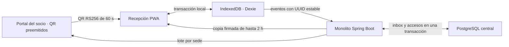

# M2 offline: operación, reconciliación y defensa

Fecha: 09/11/2026. Rama de implementación: `feat/m2-offline`, base `e0056b1`.
MVP autorizado por el responsable de M1/M2. La revisión de integración posterior
se registra al final; los resultados de implementación conservan su corte original.
Fuentes: TP oficial (21 páginas), RF-04/05, RN-01 y RNF-01; Lineamientos oficiales
(25 páginas), secciones 5.2–5.4. Dos horas es una decisión del MVP, no una cifra del TP.

## Arquitectura y decisiones



Se reutilizan React/Vite, Spring Security, JJWT y PostgreSQL. Dexie simplifica
transacciones IndexedDB; jose verifica RS256; Workbox precachea recursos estáticos.
No hay servidor local, broker, replicación de PostgreSQL ni dependencia cloud.
Se descartó un agente Java/SQLite por instalación y operación adicionales en cada sede.
No se cambian pagos, estados de M1, precios ni roles comerciales.

Archivos nuevos principales:

| Área | Archivos |
|---|---|
| Backend `acceso/offline/` | FirmaOffline, CredencialOfflineService, TerminalOfflineService, SincronizacionOfflineService y OfflineController |
| Frontend `services/offline/` | crypto.js, db.js, api.js, movimientos.js y sync.js |
| Pantallas M2 | PrepararQrOffline.jsx, QrOffline.jsx, TerminalOffline.jsx y OfflineAcceso.css |
| PWA | src/sw.js y scripts/build-pwa.mjs |
| Pruebas | FirmaOfflineTest, OfflineIntegrationTest, test-offline.mjs, e2e-m2-offline.mjs y scripts/prueba-m2-offline.ps1 |
| Persistencia | V11__credenciales_m2_offline.sql, V12__terminal_y_copia_m2.sql y V13__reconciliacion_m2_offline.sql |

Hay un terminal principal y un operador autorizado por sede en este MVP. El UUID
del navegador no basta: el backend exige RECEPCIONISTA activo, sede operativa y
coincidencia del operador registrado. Cambiar de equipo/operador requiere coordinación
administrativa; no se agregó una nueva consola ni se sustituye silenciosamente al titular.

## Preparación y privacidad

1. El socio inicia sesión, abre Mi QR, elige sede y prepara las credenciales offline.
2. Recepción inicia sesión y usa «Preparar / actualizar terminal», después de que los
   socios hayan preparado sus lotes. La copia sólo incluye a esos socios para esa sede.
3. Se verifica y guarda la copia firmada. La aplicación solicita persistencia al navegador;
   si no la concede, lo informa. Nunca presenta una copia como guardada si falla IndexedDB.

El snapshot contiene revisión, terminal, operador, sede, capacidad, nombre/ID mínimos,
cuenta habilitada, suspensión conocida, intervalos no cancelados, lotes autorizados y
presencia conocida. No incluye fotos, DNI, email de socios, contraseñas ni claves privadas.
El email del operador vincula la sesión local al permiso firmado. No replica todo el padrón;
el límite técnico es 1000 socios preparados por copia, con error explícito si se supera.
Los snapshots anteriores permanecen en el servidor como evidencia de captura.

La autoridad offline caduca a las dos horas. El reloj se corrige al preparar; se controla
retroceso persistido y cambios de más de 30 segundos durante la sesión mediante reloj
monótono. No hay gracia en exp/nbf: el QR vence exactamente al terminar su ventana.
El servidor rechaza capturas futuras de más de 30 segundos. No constituye un reloj
hardware resistente a manipulación: presupone terminal y perfil del navegador administrados.

`/terminal-offline` y `/qr-offline` se abren sin el Layout que consulta al servidor.
El terminal comprueba el permiso firmado, incluso si caducó el JWT de login; no permite
iniciar una autorización nueva sin conexión. Para sincronizar exige nuevamente sesión
central válida del operador original. Un cambio de cuenta no reutiliza la copia ajena.
Logout borra el acceso rápido al QR del socio, sin borrar pendientes del terminal.

## Clave privada y continuidad tras reiniciar Spring

Configurar **fitzone.offline.private-key**, mediante `FITZONE_OFFLINE_PRIVATE_KEY`, con
una clave RSA privada PKCS8 en base64, de al menos 2048 bits. Es exclusiva de M2; no
deriva del secreto de autenticación. Debe mantenerse igual al reiniciar Spring.
Sin esa configuración, preparar offline devuelve **503**; M1/M2 online siguen disponibles.
Nunca se genera silenciosamente una clave temporal para credenciales de dos horas.

La plantilla [.env.example](../.env.example) enumera perfil, puerto, conexión a BD,
JWT_SECRET, FITZONE_OFFLINE_PRIVATE_KEY y VITE_API_URL. No contiene claves privadas
ni contraseñas reales. Preparar desde la raíz, con Node disponible:

```powershell
node scripts/preparar-config-m2.mjs
```

El comando crea `.env` desde la plantilla si falta y completa únicamente JWT_SECRET
y la clave RSA vacíos. Repetirlo conserva exactamente las claves existentes; una
RSA inválida se rechaza sin sobrescribir el archivo. Nunca se ejecuta al arrancar
Spring. `.env` y sus variantes se excluyen tanto de Git como del contexto Docker.
No imprimir/adjuntar el archivo; protegerlo y respaldarlo como secreto del proyecto.
El archivo usa KEY=VALUE, sin comillas ni valores multilínea.

Completar DB_PASSWORD con la contraseña de la BD elegida. Para el PostgreSQL del
Compose actual, usar la credencial de desarrollo que declara ese archivo, no una
contraseña personal. Ajustar DB_URL si el host/puerto es diferente. Spring Boot no
carga `.env` automáticamente: inyectar sus valores explícitamente en el proceso.
Ejemplo PowerShell, con JDK 21 y dependencias instaladas:

```powershell
# Cargar sólo en esta consola; no cambia el entorno global de Windows ni imprime secretos.
Get-Content -LiteralPath .env | ForEach-Object {
  if ($_ -match '^([A-Z][A-Z0-9_]*)=(.*)$') {
    [Environment]::SetEnvironmentVariable($matches[1], $matches[2], 'Process')
  }
}
# Con la BD disponible (el Compose actual sólo inicia PostgreSQL):
./mvnw.cmd spring-boot:run
```

En otra consola cargar el mismo `.env`, instalar `frontend` sólo si faltan sus
dependencias, y ejecutar `npm --prefix frontend run build` y
`npm --prefix frontend run preview -- --host 127.0.0.1`. La API usa puerto 3000 y el
preview 4173 por defecto; el proxy `/api` del preview hereda el de Vite y apunta a
localhost:3000. `VITE_API_URL=/api/v1` conserva el mismo origen. Para cambiar puerto
backend también debe ajustarse el destino del proxy. No usar npm run dev como demo
de disponibilidad offline: requiere el build y el service worker.

En esta notebook sin JDK local, el runner Docker de la demostración ya es un camino
aislado reproducible: genera sus propios secretos de prueba, no toma claves personales,
y verifica persistencia al reiniciar Spring. No requiere modificar el Compose ni usar
la base de desarrollo. Ver los comandos de demostración más abajo.

**Dependencia del cierre global Docker:** docker-compose.yml actualmente sólo define
PostgreSQL. No define backend/frontend ni entrega estas variables a Spring; crear
`.env` no soluciona eso por sí solo. El cierre global deberá agregar el backend con
`env_file: .env` (o secretos equivalentes), DB_URL con host `postgres`, frontend servido
con build PWA y un proxy de API, y mantener la misma clave externa al reconstruir la
imagen. Esos cambios no se implementan en este cierre de M2. El Dockerfile actual sólo
copia código/pom/wrapper; no se debe incorporar `.env` a la imagen.

En despliegue usar el gestor de secretos del entorno y acceso restringido. No rotar
la clave con credenciales o movimientos pendientes: este MVP no incorpora un anillo
de claves antiguas. La E2E usa una clave generada para su servidor aislado y elimina
su archivo de entorno al finalizar. Los perfiles temporales no son configuración de
operación ni se necesitan para arrancar una instalación nueva.

## QR y compatibilidad online

El lote tiene hasta 120 JWT RS256, con ventanas contiguas de 60 segundos y horizonte
máximo de dos horas, alineado al minuto. Cada token incluye tipo `m2-qr`, uid, sid,
bid y jti. La privada no sale del servidor; al terminal y socio sólo llega JWK pública.
Una captura anterior no sirve en el minuto siguiente. No se aceptan token malformado,
firma alterada, tipo distinto, sede ajena ni token fuera de su ventana.

Se permite **un ingreso por jti**; después de egresar debe usarse el siguiente QR.
El mismo QR vigente puede identificar el egreso. Un reintento del mismo evento usa
su UUID original; no es una nueva admisión. Preparar otra vez en el mismo minuto
reutiliza el lote del socio/sede. Otros lotes no se revocan instantáneamente durante
una desconexión; siguen limitados por ventana y copia autorizada.

El QR online anterior conserva HMAC, `codigo_qr` y la comparación del último emitido.
Los lotes offline tienen otro tipo y otro circuito: se leen en el panel de terminal
preparado, incluso con conexión, y se envían mediante el protocolo de reconciliación.
No se envía un token offline al POST online tradicional. Con central disponible,
el panel sincroniza pendientes y renueva la copia antes de admitir una nueva operación.
Así no usa deliberadamente una suspensión vieja cuando puede consultar al central.

## Transacción local y aforo

`registrarLocal` verifica firma, permiso, sede, lote y períodos. Para ingreso exige
cuenta habilitada, sin suspensión y un intervalo que cubra la captura; bloquea presencia
conocida en cualquier sede. Para egreso exige visita abierta de su sede, por QR o
ID de visita/número central. No exige renovar la membresía para poder salir.

Una transacción Dexie guarda evento, presencia, uso del QR y secuencia. Lecturas y
escrituras comparten los mismos stores: dos pestañas no pueden confirmar el mismo
ingreso local. Si falta espacio o aborta IndexedDB, no se anuncia éxito. El resultado
es **provisional** hasta recibir confirmación central. Cerrar/reabrir conserva la cola.

El aforo local parte de la presencia conocida y se actualiza con movimientos locales.
Está marcado provisional; otras sedes y cambios centrales pueden ser desconocidos.
Los conflictos requieren revisión. Al actualizar la copia se conservan las presencias
locales en conflicto hasta registrar su egreso; no se borran por una cifra central.
El egreso de una visita cuyo ingreso fue rechazado/conflictivo conserva ese resultado,
sin quedar esperando para siempre un ingreso ya conciliado. Una copia caducada
no admite movimientos nuevos, pero no elimina eventos históricos pendientes.

## Contratos y persistencia central

Prefijo `/api/v1/accesos/offline`, contratos completos en OpenAPI:

| Método/ruta | Resultado |
|---|---|
| POST `/credenciales` | Socio con vigencia prepara lote para sede; no-store |
| POST `/preparacion` | Recepción registra/autoriza su terminal y obtiene copia; no-store |
| GET `/conexion` | 204 autenticado; comprueba comunicación real con la API |
| POST `/sincronizacion` | Hasta 100 eventos; resultado por UUID, no-store |

V11 crea los lotes autorizados; V12 terminal y copia firmada; V13 inbox, intentos
incompatibles y referencia de visita/terminal en registro_acceso. V1–V10 no se editan.
Las columnas nuevas de accesos son null para las cuentas/visitas históricas.

El evento conserva UUID, visita local o referencia central, usuario, tipo, captura,
revisión, QR como evidencia y secuencia. El servidor deriva sede/operador del terminal:
no confía en esos valores enviados por el cliente. La copia original se recupera por
revisión y se verifica al instante de captura. Estar caducada al recibir no invalida
automáticamente un movimiento capturado durante la ventana válida.

Inbox, resultado y acceso se confirman en la misma transacción. Se bloquea el terminal
y luego los titulares en orden; el escritor online comparte el bloqueo por titular.
V4 sigue siendo garantía SQL de ingreso abierto único. Para offline se comprueban
también intervalos históricos, que el índice parcial por sí solo no cubre.

Resultados: CONFIRMADO, CONFLICTO, RECHAZADO o EN_ESPERA. Este último conserva el
pendiente si falta un ingreso/egreso necesario para reconstruir la visita. El servidor
puede completar ambos extremos al recibirlos desordenados. Se aplica el cierre diario
existente al importar visitas antiguas que no deben alterar el aforo de hoy.

Repetir el UUID y contenido devuelve el resultado almacenado con `repetido=true`.
Cambiar el contenido con el mismo ID registra un intento incompatible y conserva el
original. Los conflictos no sobrescriben la visita central. La cola sólo cambia a
confirmada tras ACK explícito; errores de transporte o cambio de sesión la conservan.
La sincronización se intenta al abrir, al evento online, cada 10 s y manualmente.
Web Locks comparte exclusión de envío entre pestañas; la idempotencia central protege
incluso si el navegador no ofrece esa API. Los pendientes en espera no bloquean para
siempre el envío de eventos posteriores: se alternan por último intento.

## Política RN-01 y límites reales

Se prioriza continuidad con admisiones provisionales. No es posible asegurar ausencia
de doble presencia global entre sedes aisladas que admiten con copias independientes.
Al reconectar, solapamientos/presencias incompatibles quedan auditados como conflictos;
la evidencia de lo ocurrido físicamente no se borra. Resolver administrativamente esos
conflictos está fuera del MVP; no se implementan GET/PATCH generales que seguían en 501.

Una suspensión o inactivación posterior al snapshot puede desconocerse hasta reconectar.
Lo mismo ocurre con una cancelación posterior de un período pagado.
La reconciliación conserva la decisión sustentada por la copia válida al capturar;
no presenta esa información como conocimiento en tiempo real. La ventana de dos horas
acota el riesgo, sin eliminarlo. Un socio no preparado o no incluido en la copia no
recibe una autorización nueva durante la caída. Tampoco se garantiza almacenamiento
frente a borrado del perfil, pérdida del equipo o intervención de un administrador.

La cola y los resultados locales permanecen para revisión; la copia se reemplaza al
preparar nuevamente sin pendientes. La caducidad limita autorización, no elimina la
evidencia histórica. El dispositivo debe estar protegido y no ser de uso público.
Disponibilidad 99,5 % exige medición operativa; una demo funcional no acredita esa cifra.

## Ejecución y demostración reproducible

Usar el build de producción sobre HTTPS o localhost; `npm run dev` no prepara service
worker. Preparar ambos clientes antes de cortar red y abrir las rutas de contingencia.
En operación manual, esperar más de un minuto, comprobar rotación/rechazo anterior,
ingresar, cerrar/reabrir el terminal, egresar y reconectar. Verificar ACK y aforo;
un error no implica que el servidor no haya confirmado.

E2E automatizada desde la raíz, Docker Desktop abierto y Chrome instalado:

```powershell
./scripts/prueba-m2-offline.ps1
# Si se necesita elegir otro runtime compatible:
./scripts/prueba-m2-offline.ps1 -Node 'ruta/al/node.exe'
```

En esta notebook la ejecución usó Node 24.22.1 ya disponible en el runtime. Para
seleccionarlo sin instalar nada globalmente:

```powershell
$nodePruebas = (Get-Command node -All | Where-Object Source -Like '*CodexPrimaryRuntime*' | Select-Object -First 1).Source
./scripts/prueba-m2-offline.ps1 -Node $nodePruebas
```

En otro equipo seleccionar su Node compatible (Playwright requiere Node >=20).
El Node 24.15.0 de esta máquina abortó en un intento; no se atribuye ese fallo al backend.

El runner construye la PWA, usa el target build Java 21 `fitzone-tests:local` y crea
PG 18 en tmpfs, sin compartir volúmenes. Si falta la imagen, construirla con el runner
backend documentado en pruebas.md. Crea fixtures por HTTP/SQL sólo en esa PG. Chrome
usa perfiles nuevos bajo target, nunca el perfil personal del usuario.
Pausa Spring, desconecta ambos navegadores durante 65 s, prueba persistencia tras
cerrar Chrome y reinicia Spring con la misma clave. El proxy de prueba deja confirmar
el batch central y corta sus respuestas hasta liberar el ACK. SQL y replay HTTP
comprueban exactamente una visita cerrada y dos eventos confirmados.

El finally de Node y el supervisor PowerShell eliminan únicamente sus contenedores,
incluso ante fallos; no usan prune ni borran volúmenes de desarrollo. Evidencia en
target/e2e-m2/<uuid> (resultado.json, capturas y logs); sólo un resultado con aprobada=true
acredita el recorrido. No se versionan perfiles, logs ni credenciales temporales.

## Correspondencia para ADR oficiales

Este contenido prepara dos decisiones, sin sobrescribir ni renumerar ADR existentes:

- **ADR-003 oficial:** estrategia PWA, verificación RS256 pública, copia de dos horas,
  transacciones locales y continuidad provisional. Alternativa descartada: agente
  Java/SQLite por complejidad operativa. Consecuencias: preparación previa, navegador
  administrado y imposibilidad de revocación inmediata durante partición.
- **ADR-007 oficial:** réplica acotada por lote/sede, actualización explícita del snapshot,
  reintento cada 10 s y al reconectar, inbox idempotente y conflictos auditados.
  Alternativas descartadas: reenvío ciego al POST online y replicación total de BD.
  Consecuencias: consistencia diferida, aforo provisional y revisión de conflictos.

Estado técnico: implementado y revisado para integración. Fecha:
09/11/2026. La numeración histórica del equipo ya usa ADR-007 para actores/membresías:
la correspondencia definitiva debe resolverla el grupo antes de la entrega.

## Evidencia de esta ejecución

- Backend completo: 94/94, sin fallos, errores ni omitidos. JaCoCo: 943/1083 líneas
  (87,07 %) y 400/570 ramas (70,18 %). Reportes en
  `target/test-runs/cf1cd1adad0c4a9c97cca016c6013fc9`.
- Contrato OpenAPI revisado de nuevo después de agregar 503: un test focalizado
  aprobado en `target/test-runs/2785b617a56e452f9647ce26470ff171`.
- npm test: cinco suites anteriores y script offline aprobados; build PWA correcto.
- E2E final aprobada: `target/e2e-m2/eec4c370-3ead-4fa4-967d-d954fcbbb9e3`.
  `resultado.json`, `ingreso-provisional.png`, `terminal-movil.png` y `confirmado.png`.
  Una visita cerrada, dos eventos confirmados, cero duplicados. Chrome real headless,
  red interrumpida 65 s y Spring pausado/reiniciado. Terminal y QR sin overflow a 390 px.
- No se ejecutó una prueba con lector USB, torno físico, pérdida del disco o 25
  terminales reales. No hay porcentaje de cobertura frontend ni medición de SLA.

Los intentos previos fallidos permanecen como tales en target: no se confunden con
la corrida final. El runner de prueba eliminó sus contenedores; no tocó volúmenes
persistentes de desarrollo. El corte de implementación e5769c8 se entregó sin
merge/push; la revisión posterior para integración se registra debajo. Sin tag final.

## Qué entender para defenderlo

1. **[FirmaOffline](../src/main/java/com/fitzonesports/acceso/offline/FirmaOffline.java) y [CredencialOfflineService.preparar](../src/main/java/com/fitzonesports/acceso/offline/CredencialOfflineService.java):** la privada firma en Spring;
   jose verifica con pública. Los 120 tokens existen antes de desconectarse: el socio
   selecciona la ventana vigente, no inventa un JWT. Pregunta: ¿por qué no copiar el
   secreto del login? Permitiría suplantación y falsificación; la clave es exclusiva.
2. **[TerminalOfflineService.preparar](../src/main/java/com/fitzonesports/acceso/offline/TerminalOfflineService.java):** permiso/DTO y consultas acotadas, no réplica
   de entidades completas. Pregunta: ¿por qué guardar intervalos y no ACTIVA? Una
   membresía puede vencer o tener períodos futuros/huecos durante la desconexión.
3. **[movimientos.js](../frontend/src/services/offline/movimientos.js) → Dexie:** una transacción une movimiento, presencia y uso del
   QR. Pregunta: ¿qué ocurre si falla el último write? Todo revierte y no se muestra
   éxito; los tests inyectan falta de espacio para comprobarlo.
4. **[sync.js](../frontend/src/services/offline/sync.js) → [OfflineController](../src/main/java/com/fitzonesports/acceso/offline/OfflineController.java) → [SincronizacionOfflineService](../src/main/java/com/fitzonesports/acceso/offline/SincronizacionOfflineService.java) → PostgreSQL:** el
   UUID identifica intención; @Transactional confirma inbox y acceso; los bloqueos
   coordinan escritores y el índice protege presencia abierta. Pregunta: ¿por qué
   no confiar sólo en el índice? No cubre solapamientos de visitas ya cerradas.
5. **E2E real:** distingue mocks de transporte, MockMvc/PG y navegador/HTTP. Pregunta:
   ¿cómo sé que la pantalla no simula offline? Spring está pausado, los clientes sin
   red, Chrome se reabre y SQL verifica exactamente una visita tras replay/ACK perdido.

## Revisión para integración — 09/11/2026

Se verificaron los seis commits hasta e5769c8 frente a main e0056b1, permisos por
operador/sede, deduplicación y evidencia de conflictos. V1–V10 permanecen intactas.
No se encontraron secretos reales nuevos en el diff ni archivos generados versionados.
La configuración se completa con .env.example, generador explícito y exclusión de
secretos de Git/Docker; no cambia el backend ni el frontend funcional de la E2E.

Se reutilizan los 94 tests backend y la E2E aprobada, porque sus fuentes no cambiaron.
Se volvieron a ejecutar npm test y build PWA, ambos correctos. La comparación de
cobertura por clase/método conserva las ramas anteriores (287/376); las nuevas
offline agregan 113/194. Desglose completo en pruebas.md, sin agregar tests para
subir un porcentaje. El generador de entorno conserva las claves entre ejecuciones
y rechaza una RSA/base64 inválida sin tocar el archivo existente.

La integración puede realizarse por fast-forward, conservando los commits de la
rama, después de actualizar origin/main y validar el árbol temporal. La publicación
fue autorizada por el responsable; el HEAD remoto exacto se verifica al publicarlo.
Se mantiene pendiente el cierre global Docker descrito arriba, la resolución
administrativa de conflictos y la correspondencia grupal de ADR-003/007.
