# FitZone Sports — Manual de usuario

| Versión | Fecha | Responsable de autoría |
| --- | --- | --- |
| 1.1 | 19/11/2026 | Equipo FitZone Sports |

Edición para el Trabajo Integrador Final. Contrastado con la aplicación integrada en `main` (commit `9ecafcc`, más la corrección de `frontend/nginx.conf`), levantada con `docker compose up --build -d`. Todas las capturas se tomaron en esa misma instancia el 19/11/2026.

## Índice

- [1. Introducción](#introduccion)
- [2. Cómo utilizar este manual](#como-utilizar)
- [3. Manual del Socio](#socio)
  - [3.1 Registro y carga del perfil](#registro-perfil)
  - [3.2 Contratación y renovación de membresías](#membresias)
  - [3.3 Obtención del código QR y acceso al gimnasio](#qr)
  - [3.4 QR rechazado o sede sin conexión](#contingencia)
  - [3.5 Reserva de clases grupales y lista de espera](#reserva-clases)
  - [3.6 Reserva de canchas y cálculo del precio](#reserva-canchas)
  - [3.7 Cancelaciones, plazos y penalidades](#cancelaciones)
  - [3.8 Comprobantes de pago](#comprobantes)
- [4. Manual del Recepcionista / Administrador de sede](#recepcion)
  - [4.1 Validación de ingresos y control de aforo](#acceso-aforo)
  - [4.2 Gestión de agenda de clases](#agenda)
  - [4.3 Inhabilitación de canchas por mantenimiento](#mantenimiento)
  - [4.4 Problemas frecuentes](#problemas-mostrador)
- [5. Manual del Gerente central](#gerencia)
  - [5.1 Alta y configuración de sedes](#sedes)
  - [5.2 Configuración de precios, descuentos y horario pico](#precios)
  - [5.3 Reportes consolidados](#reportes)
  - [5.4 Usuarios y membresías](#usuarios)
- [6. Preguntas frecuentes](#preguntas)
- [Fuentes y estado de las capturas](#fuentes-capturas)

## 1. Introducción

FitZone Sports reúne en un portal la gestión de una cadena de gimnasios y canchas deportivas. Desde tu cuenta podés contratar una membresía, consultar su vigencia, mostrar una credencial QR, reservar clases y canchas, seguir tus reservas y descargar los comprobantes de tus pagos. Recepción opera el acceso, la agenda de clases y las canchas de su sede. Gerencia consulta la cadena y administra sedes, planes, tarifas y usuarios con alcance global, y lee los reportes consolidados.

La contratación, la renovación y el cobro de reservas usan una pasarela simulada. Los importes y las devoluciones que aparecen corresponden a operaciones de demostración y no hay cargos reales.

## 2. Cómo utilizar este manual

Los nombres en **negrita** corresponden a opciones visibles en el portal. En una pantalla angosta, abrí el menú con el botón **Abrir menú de navegación**. El nombre o avatar del encabezado abre **Perfil**. Usá **Cerrar sesión** en un equipo compartido una vez finalizada la operación. Recepción debe conservar la sesión y el perfil del navegador mientras tenga movimientos offline pendientes.

| Disponibilidad | Qué podés hacer |
| --- | --- |
| **Disponible desde el portal** | Seguí los pasos indicados en la interfaz. |
| **Sólo por API** | La operación existe en el sistema, pero el portal no tiene pantalla. Pedí a personal autorizado que use la integración indicada. |
| **No implementado** | La función todavía no produce un resultado utilizable. |

| Perfil | Inicio y alcance |
| --- | --- |
| **Socio / Cliente** | Empieza en **Mi membresía** (socio) o **Elegí tu plan** (cliente sin plan). El socio con membresía vigente dispone de **Mi QR**. Cualquier cuenta puede consultar y reservar **Canchas** y ver **Mis reservas** y **Mis pagos**. |
| **Recepción / Administración de sede** | Empieza en **Control de acceso**. Trabaja sobre la sede asignada a su cuenta. |
| **Gerente central** | Empieza en **Panel general**. Consulta y administra las sedes de la cadena según el permiso de cada operación. |

**Glosario.** Un *período* es el tramo contratado de un plan. La *sede habitual* es la referencia de tu cuenta. El *aforo* muestra cuántas personas tienen un ingreso abierto respecto de la capacidad de la sede. Una *retención* aparta un turno de cancha durante unos minutos mientras esperás para pagarlo. Un *movimiento provisional* quedó guardado en el terminal offline y está sujeto a confirmación central. La *lista de espera* asigna una posición y puede generar una oferta de cupo. Las horas se interpretan en hora argentina.

## 3. Manual del Socio

El menú del Socio se organiza así: **Actividades** (**Clases**, **Canchas**), **Mi espacio** (**Mi membresía**, **Mis reservas**, **Mis pagos**) y **Servicios** (**Mi QR**).

### 3.1 Registro y carga del perfil

**Disponibilidad.** Disponible desde el portal.  
**Objetivo.** Crear tu cuenta y actualizar tus datos o tu foto de perfil.  
**Perfil.** Persona que se registra. Las ediciones corresponden al titular de la cuenta.  
**Antes de empezar.** Tené tu DNI, correo, una contraseña de al menos 8 caracteres y una foto PNG o JPEG. La foto admite hasta 2 MB, 4096 píxeles por lado y 8 megapíxeles.

1. En el inicio de sesión, elegí **Registrarse**.
2. Completá **Nombre**, **Apellido**, **DNI**, **Email**, **Contraseña** y **Repetir contraseña**. Adjuntá la **Foto de perfil** y pulsá **Registrarme**.
3. Una vez dentro, abrí **Perfil** desde el nombre o avatar del encabezado. Ahí ves tus **Datos personales** (correo, DNI y sede habitual).
4. Para cambiar tus datos, elegí **Editar perfil** y luego **Guardar cambios**. Para cambiar la imagen, elegí otro archivo y pulsá **Guardar foto**.

**Resultado esperado.** Se inicia tu sesión y el portal te lleva a elegir un plan. Después de una edición, el dato o la foto actualizados aparecen en **Perfil**. La sede habitual se confirma en la primera contratación.

**Si hay un problema.** Verificá que las contraseñas coincidan y que el archivo cumpla los límites. Si el correo o DNI ya está registrado, usá tu cuenta existente o consultá con administración. Si falla la carga del perfil, usá **Reintentar consulta del perfil**.

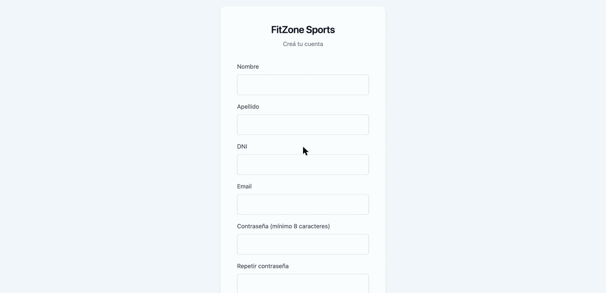

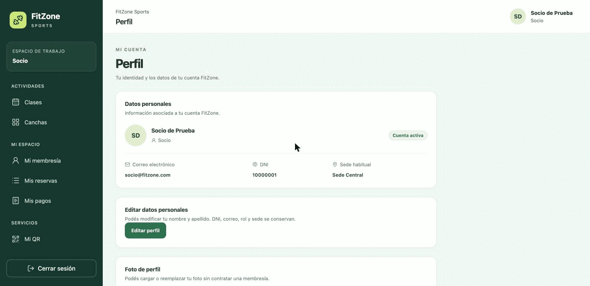

### 3.2 Contratación y renovación de membresías

**Disponibilidad.** Disponible desde el portal.  
**Objetivo.** Contratar un primer período o extender una membresía existente.  
**Perfil.** Titular de la cuenta.  
**Antes de empezar.** Iniciá sesión con conexión. Debe haber un plan activo. El primer alta necesita una sede habitual.

1. Sin membresía, el portal te lleva a **Elegí tu plan**. Compará duración y precio (por ejemplo Mensual, Trimestral, Anual y Anual Premium) y pulsá **Elegir este plan**.
2. En **Plan seleccionado**, elegí **Tu sede habitual**. Si tu cuenta ya tiene una sede guardada, el portal la conserva. Pulsá **Confirmar contratación**. El portal avisa que se procesa un pago simulado, sin cargos reales.
3. Si ya tenés una membresía, entrá en **Mi membresía**. Ahí ves el plan, el importe, la sede habitual, la **Vigencia del período actual** con los días restantes y el **Próximo período**. El portal ofrece **Renovar plan** cuando el período vigente entra en sus últimos siete días y no hay continuidad programada ni renovación automática activa. Para una membresía vencida, muestra **Renovar membresía**.
4. Elegí un plan activo, revisá el importe y pulsá **Confirmar renovación**. En **Renovación automática** podés usar **Activar** o **Desactivar**. La automática usa el último plan contratado y su precio vigente.

**Resultado esperado.** Si el pago simulado se aprueba, el período aparece en **Pagos de membresía** y en tu historial. Una renovación anticipada agrega el período a partir del fin del anterior. Si ya venció y no quedan períodos futuros, comienza desde la nueva contratación. Desactivar la automática conserva los períodos pagados.

**Si hay un problema.** Si el resultado quedó incierto, primero revisá **Mi membresía** y usá **Reintentar contratación** o **Reintentar renovación pendiente** cuando aparezcan. Eso conserva la misma operación. Si se rechazó el pago, revisá el aviso antes de volver a intentar. Si la cuenta está suspendida, consultá con administración.

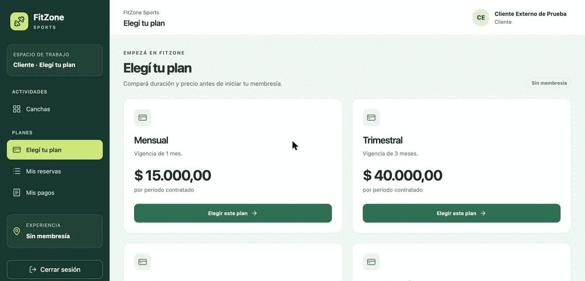

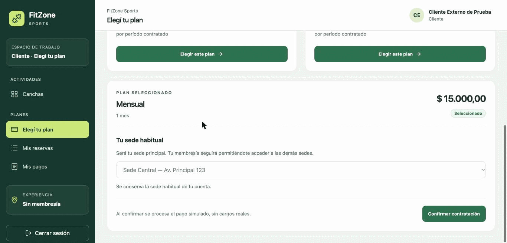

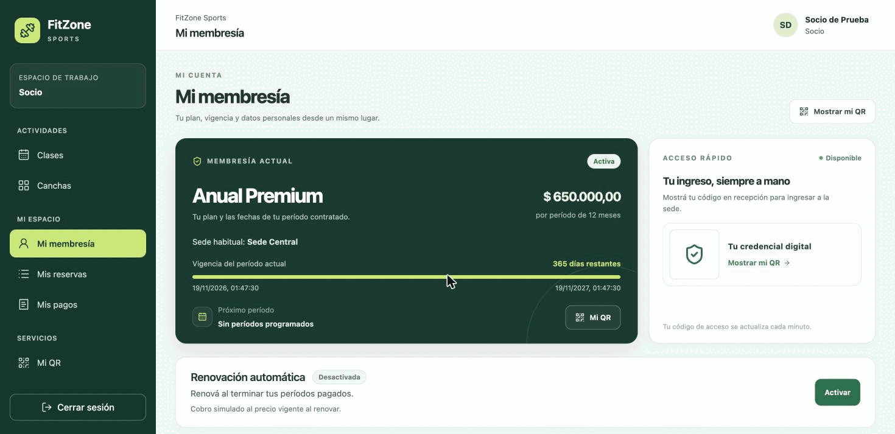

### 3.3 Obtención del código QR y acceso al gimnasio

**Disponibilidad.** Disponible desde el portal.  
**Objetivo.** Presentar una credencial vigente para ingresar o salir del gimnasio.  
**Perfil.** Socio titular con cuenta activa y membresía vigente.  
**Antes de empezar.** Iniciá sesión. Abrí la credencial con conexión al menos una vez antes de depender del modo sin conexión.

1. Elegí **Mi QR** en el menú, o **Mostrar mi QR** desde **Mi membresía**.
2. Esperá a que aparezca **Acceso a Sede - Credencial Digital**. El código se renueva solo cada minuto y la pantalla indica cuánto falta (**Vence en…**).
3. Mostrá el código vigente a Recepción: el recepcionista lo escanea con la cámara, tanto al entrar como al salir. Pulsá **Cerrar** cuando termines.

**Resultado esperado.** Recepción valida el movimiento en la sede que estás visitando. Podés acceder a otras sedes con la misma membresía vigente.

**Si hay un problema.** Si no aparece **Mi QR**, revisá la vigencia y el estado en **Mi membresía**. Si el código fue reemplazado, venció o ya se usó, mostrá el que se ve en ese momento. La sección [3.4](#contingencia) explica qué revisar si la sede perdió conexión.

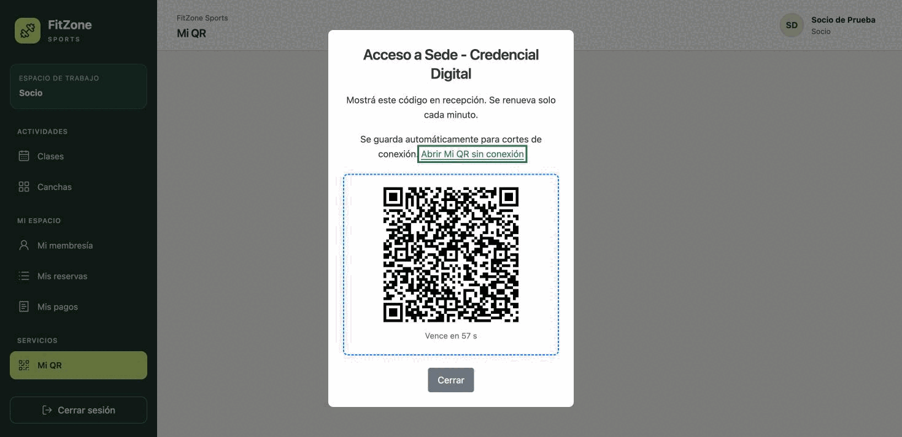

### 3.4 Qué hacer si el QR es rechazado o la sede está sin conexión

**Disponibilidad.** Disponible desde el portal y la PWA preparada.  
**Objetivo.** Resolver un rechazo o presentar una credencial durante un corte.  
**Perfil.** Socio titular. Recepción determina si puede validar el movimiento.  
**Antes de empezar.** Para acceder sin Internet propio necesitás la PWA preparada en el mismo navegador y una autorización vigente guardada al abrir **Mi QR** con conexión. Para aceptar durante un corte, la sede necesita su terminal previamente preparado ([4.1](#acceso-aforo)).

1. Si te rechazan el QR, revisá que la cuenta y el período sigan vigentes. Mostrá el código actual. Si quedó un ingreso abierto, pedí a Recepción que revise el movimiento anterior.
2. Si Recepción perdió conexión y tu teléfono aún tiene Internet, abrí **Mi QR** de forma habitual y mostrá la credencial actual.
3. Si tu teléfono también está sin conexión, abrí la PWA guardada y usá **Abrir Mi QR sin conexión**, un enlace que aparece debajo del texto *Se guarda automáticamente para cortes de conexión* en la credencial.
4. Esperá la indicación de Recepción. Registrará el movimiento como provisional y al reconectar lo enviará al sistema central.

**Resultado esperado.** La autorización guardada se puede usar dentro de su vigencia (hasta dos horas, o menos si vence el período pagado). El ingreso provisional puede quedar confirmado o requerir revisión al sincronizar.

**Si hay un problema.** Si la pantalla indica que la autorización no existe o venció, buscá conexión y abrí **Mi QR**. Si el terminal está sin preparar o su copia venció, pedí a Recepción que recupere la conexión y la actualice. Si una membresía está suspendida o vencida, pedí la revisión de tu cuenta.

### 3.5 Reserva de clases grupales y lista de espera

**Disponibilidad.** Disponible desde el portal.  
**Objetivo.** Reservar una clase o anotarte para recibir una oferta de cupo.  
**Perfil.** Socio con membresía vigente.  
**Antes de empezar.** Iniciá sesión y elegí una clase programada. La reserva directa y el alta en espera cierran 48 horas antes del comienzo.

1. Entrá en **Clases** y elegí **Sede** y, si querés, **Día (opcional)**. Usá **Actualizar** si el listado quedó viejo. Cada ficha muestra el horario, los lugares disponibles y el instructor.
2. Si hay cupo, pulsá **Reservar**. Aparece el aviso **Tu reserva está confirmada**; elegí **Ir a mis reservas** o **Cerrar**. La ficha pasa a mostrar *Tenés un lugar reservado*.
3. Si la clase está llena y la inscripción sigue abierta, elegí **Anotarme en la lista de espera**. La ficha muestra *En espera, posición N* y puedes retirarte con **Salir de la lista de espera**.
4. Cuando aparezca una oferta, aceptala antes de la hora indicada con **Aceptar el lugar**. Para dejarla pasar usá **Rechazar**. El portal avisa que las ofertas duran hasta 8 horas y nunca más allá de 1 hora antes del inicio.
5. Podés ver todas tus clases en **Mis reservas** → bloque **Clases** (también desde el botón **Mis reservas**, arriba a la derecha).

**Resultado esperado.** Una reserva confirmada o una posición en espera. Estar en la lista no garantiza un cupo. La oferta se consulta en el portal; el aviso externo se simula en el servidor.

**Si hay un problema.** Si el cupo desapareció, actualizá y revisá si podés entrar en espera. Una reserva en otra clase que se solapa puede impedir la confirmación. Si la oferta venció o cambió tu vigencia, revisá **Mis reservas** y **Mi membresía**.

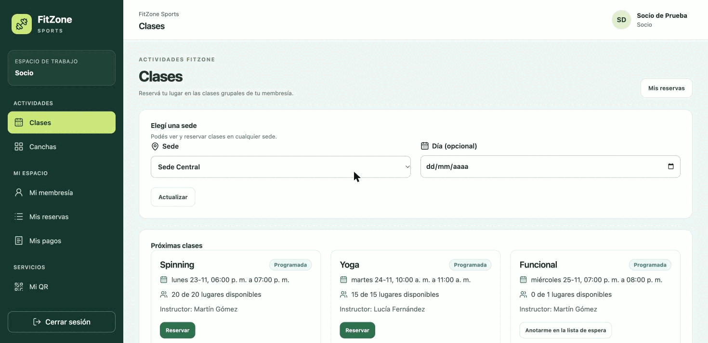

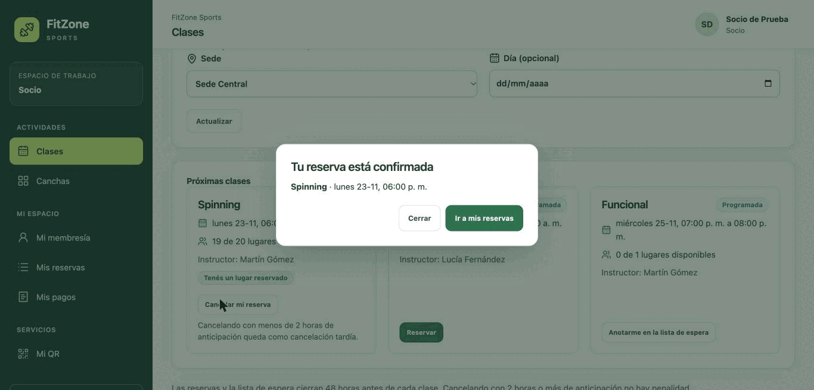

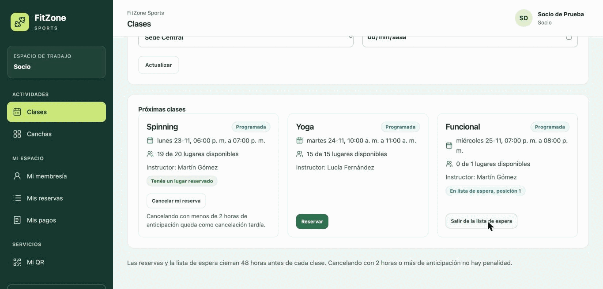

### 3.6 Reserva de canchas y cálculo del precio

**Disponibilidad.** Disponible desde el portal.  
**Objetivo.** Elegir una cancha y un turno, ver el precio exacto y pagarlo.  
**Perfil.** Socio o cliente con cuenta activa.  
**Antes de empezar.** Iniciá sesión y definí sede, cancha y fecha deseadas.

1. Entrá en **Canchas**. En **Seleccioná una sede** elegí la **Sede** (por defecto, tu sede habitual) y usá **Actualizar** si hace falta.
2. En **Catálogo de canchas**, tocá la cancha que querés (cada tarjeta muestra el tipo, el estado y la **Tarifa base** por hora).
3. En **Disponibilidad**, elegí la **Fecha**. Cada turno de una hora muestra su estado (**Disponible** u ocupado) y su precio. Si tenés membresía vigente verás **Precio socio**, el **Descuento de socio aplicado** y, si el turno cae en el horario pico, **Incluye recargo de hora pico**.
4. Pulsá **Elegir turno** en el horario deseado. Se abre **Confirmá tu turno** con la cancha, el horario, el importe y un contador (**Tiempo para pagar**): el turno queda retenido para vos hasta 10 minutos como máximo y nunca más allá de su comienzo.
5. Pulsá **Confirmar pago**. Si se aprueba, aparece **Pago aprobado** con el importe y la reserva confirmada. Desde ahí podés ir a **Ir a Mis pagos** o **Ir a mis reservas**. Si no querés pagar, elegí **Salir**: el turno se libera.

**Cómo se calcula el precio.** El importe combina la tarifa por hora del tipo de cancha y un recargo por horario pico: los minutos entre las 19:00 y las 21:00 llevan un recargo cuyo porcentaje define cada sede (20 % por defecto). A un socio con membresía vigente se le descuenta 15 % sobre el total (base más recargo). Ejemplo con Fútbol 5 a $ 20.000 la hora: un turno fuera del pico cuesta $ 20.000 al cliente y $ 17.000 al socio; un turno de 19:00 a 20:00 cuesta $ 24.000 al cliente y $ 20.400 al socio. El importe que ves es el que se cobra y se conserva en la reserva aunque después cambien las tarifas.

**Resultado esperado.** El turno queda confirmado únicamente con el pago simulado aprobado, aparece en **Mis reservas** (bloque **Canchas**) y su comprobante en **Mis pagos**.

**Si hay un problema.** Si el turno se ocupó, está en mantenimiento o venció la retención, actualizá la disponibilidad y elegí otro turno. Si se rechazó el pago, se libera el turno y no se emite comprobante.

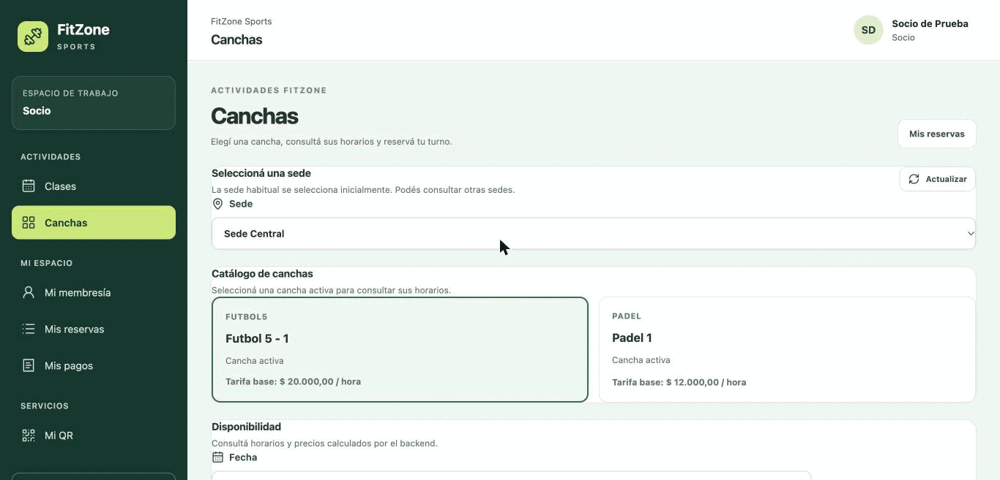

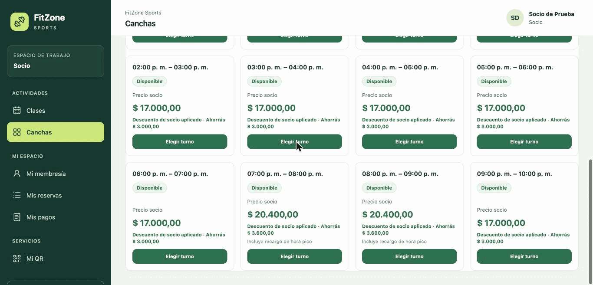

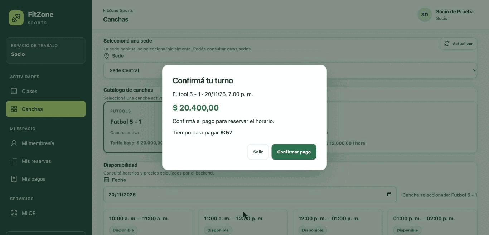

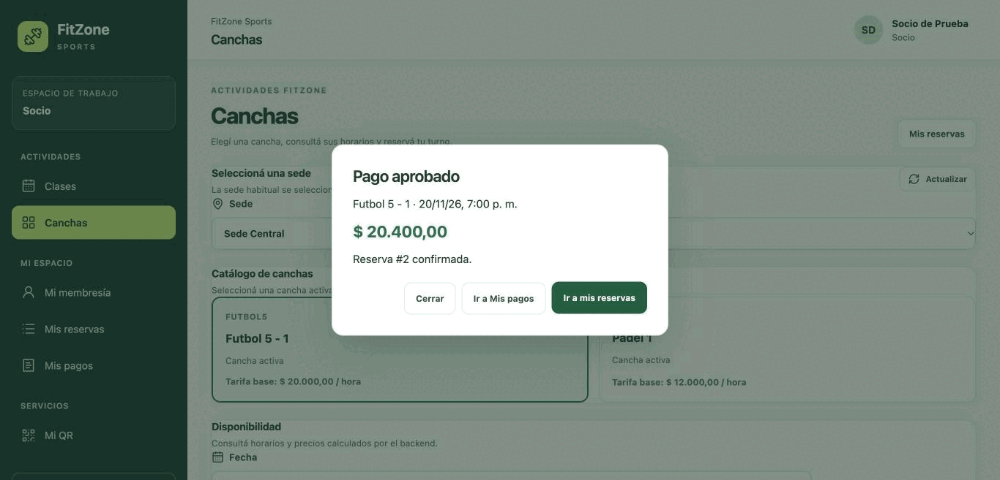

### 3.7 Cancelaciones, plazos y penalidades

Usá el procedimiento que corresponde al registro que querés cancelar. Todos se hacen desde **Mis reservas**.

| Operación | Disponibilidad y perfil | Pasos, resultado y problemas |
| --- | --- | --- |
| **Cancelar una reserva de clase** | **Portal.** Socio titular. También **API** para Recepción de la sede o Gerencia. | Abrí **Clases** y usá **Cancelar mi reserva** en la ficha, o **Mis reservas** → **Clases** → **Cancelar reserva**. Confirmá el aviso. Se libera el cupo. Con 2 horas o más de anticipación se registra como cancelación a tiempo, sin penalidad. Con menos de 2 horas se registra tardía y cuenta como falta en la respuesta; la sanción por esa falta todavía no se aplica. Una clase iniciada ya no admite cancelación individual. |
| **Cancelar una reserva de cancha** | **Portal.** Titular. También Recepción de la sede o Gerencia. | En **Mis reservas** → **Canchas**, usá **Cancelar reserva** sobre el turno y confirmá en **¿Cancelar tu turno?** con **Confirmar cancelación**. El turno se libera y la devolución depende de la anticipación: si todavía estaba retenida y sin pago, no hay devolución; con pago aprobado se devuelve 100 % con 2 horas o más de anticipación y 50 % con menos. Si ya empezó el turno, la operación se rechaza. [Política de cancha](../canchas-pagos-backend.md#reglas-operativas) |
| **Cancelar un período de membresía por arrepentimiento** | **Sólo por API.** Titular o Gerencia. | Identificá el período con un pago registrado. Pedí la cancelación antes de que se cumplan 24 horas desde el cobro. Se registra una devolución total, se desactiva la renovación automática y se conservan los demás períodos. Si el plazo venció, consultá con administración. [Condiciones del período](../membresias.md#arrepentimiento) |

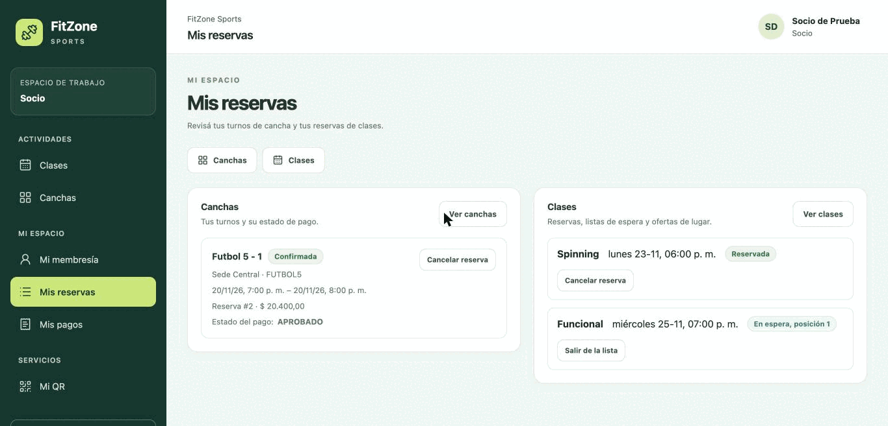

### 3.8 Comprobantes de pago

**Disponibilidad.** Disponible desde el portal.  
**Objetivo.** Consultar tus pagos y descargar el PDF de un pago aprobado.  
**Perfil.** Titular de la cuenta.  
**Antes de empezar.** Iniciá sesión y tené un pago aprobado (membresía o reserva de cancha).

1. Abrí **Mis pagos**. Cada tarjeta indica el concepto (por ejemplo **Reserva de cancha** o **Membresía - Anual Premium**), el estado (**Aprobado**), la fecha, la reserva asociada y el importe original en ARS. Los más recientes aparecen primero.
2. Pulsá **Descargar PDF** y abrí el archivo desde las descargas del navegador.

**Resultado esperado.** Obtenés el PDF original del cobro simulado. El documento se conserva aunque se reembolse el pago. Un PDF por sí solo no indica el estado de una devolución.

**Si hay un problema.** Si falla la consulta, volvé a abrir **Mis pagos**. Los pagos rechazados carecen de PDF. Si aparece un error de permiso, verificá la cuenta.

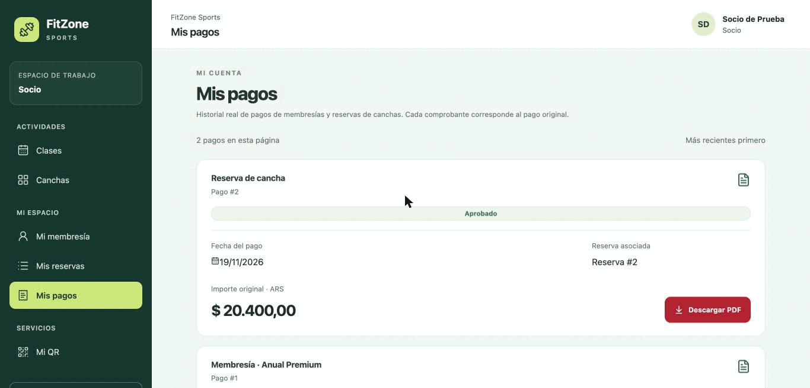

## 4. Manual del Recepcionista / Administrador de sede

El menú de Recepción tiene **Mi cuenta** (**Perfil**) y **Admin de sede** (**Control de acceso**, **Clases**, **Canchas**, **Administrar canchas**). Todo se limita a la sede asignada a la cuenta.

### 4.1 Validación de ingresos y control de aforo

**Disponibilidad.** Disponible desde el portal. Contingencia disponible en la PWA con el terminal preparado.  
**Objetivo.** Registrar entradas y salidas con el QR del socio y verificar cuántas personas hay en la sede.  
**Perfil.** Recepción opera su sede asignada. Gerencia consulta el aforo en su panel. La preparación y sincronización del terminal offline corresponden a Recepción.  
**Antes de empezar.** Iniciá sesión con tu cuenta de personal y verificá **Sede actual**. Necesitás un equipo con cámara y el permiso del navegador para usarla.

1. Abrí **Control de acceso**. En **Validar movimiento** elegí **Ingreso** o **Salida**.
2. Pulsá **Escanear QR**. Se abre el recuadro **Escanear QR**; si el navegador lo pide, concedé el permiso de la cámara y enfocá el código que muestra el socio en **Mi QR**. Pulsá **Cerrar cámara** si querés cancelar.
3. Leé el resultado antes de admitir a la persona: **Ingreso autorizado** o **Salida registrada**, con el nombre del titular, la sede, la hora y su foto. El resultado se limpia solo a los pocos segundos y se procesa una persona por vez.
4. Revisá **Aforo actual** (personas dentro respecto de la capacidad de la sede) y la ocupación. El portal refresca el dato cada 15 segundos y permite usar **Actualizar aforo**. El indicador es informativo y no bloquea los movimientos. Más abajo, **Movimientos recientes** lista los últimos movimientos confirmados por el servidor.

**Resultado esperado.** Un ingreso abierto suma al aforo de esa sede y su cierre lo resta. Si el aforo no pudo actualizarse, la tarjeta conserva el último dato disponible y su hora.

**Si hay un problema.** Si aparece **Operación denegada** o **No pudimos confirmar el movimiento**, leé el motivo antes de repetir: puede ser un QR vencido, un ingreso incompatible o una membresía sin vigencia. Ante un error de conexión, revisá **Movimientos recientes** antes de volver a escanear, porque el servidor pudo haber guardado el movimiento. Si no hay sede asignada, pedí a Gerencia que revise la cuenta.

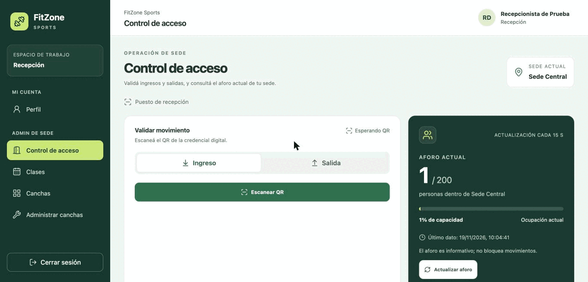

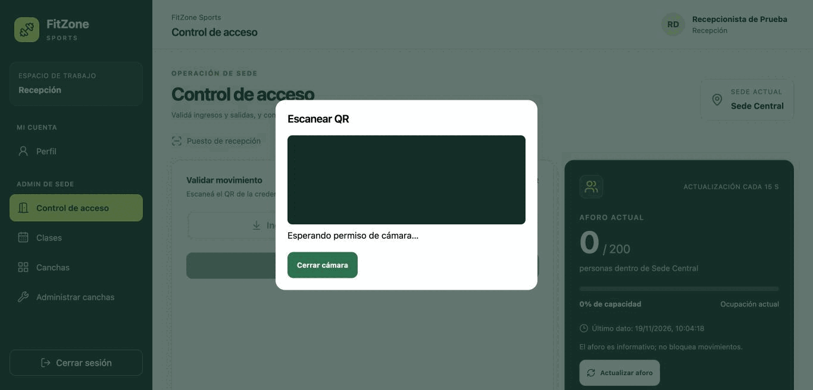

#### Preparar el terminal y trabajar durante un corte

**Disponibilidad.** Disponible en la PWA preparada.  
**Objetivo.** Conservar el control de ingresos y salidas cuando la sede no alcanza al servidor.  
**Perfil.** Recepción de la sede.  
**Antes de empezar.** Usá el equipo y perfil del navegador asignados. Con conexión y sesión válida, entrá en **Control de acceso**.

1. En el panel **Conexión y contingencia** comprobá que diga *Servidor: disponible* y pulsá **Preparar / actualizar terminal**. Verificá la sede y la hora de vencimiento de la copia: la autorización dura hasta dos horas.
2. Si se pierde la conexión, el panel muestra *Contingencia activa* y la pantalla de **Validar movimiento** sigue funcionando con el mismo botón **Escanear QR**: los movimientos quedan guardados como provisionales en el equipo.
3. Revisá **Pendientes** y el **Aforo local provisional**. Al recuperar la conexión, esperá la sincronización o usá **Reintentar sincronización**. Revisá los resultados y los conflictos o rechazos antes de considerar cerrado el movimiento.

**Resultado esperado.** Los movimientos locales quedan guardados hasta recibir respuesta central. El aforo provisional puede diferir del central. Un conflicto requiere revisión y conserva la evidencia de lo ocurrido durante el corte.

**Si hay un problema.** Si la copia venció, recuperá la conexión y actualizala cuando no haya movimientos pendientes (el botón se deshabilita mientras haya pendientes). Si la sesión expiró, volvé a ingresar con la misma cuenta y perfil del navegador. Mientras haya movimientos pendientes, conservá el perfil, los datos del navegador y la cola. Si aparecen conflictos, escalalos a la coordinación de la sede.

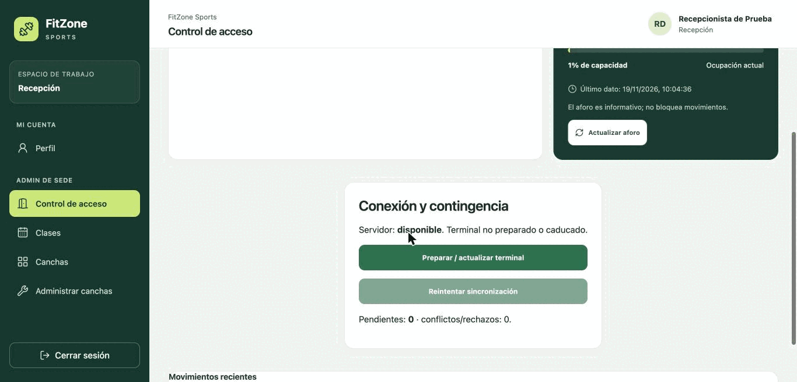

### 4.2 Gestión de agenda de clases

**Disponibilidad.** Disponible desde el portal para crear, editar, cancelar y ver reservas. El registro de asistencia todavía no está implementado.  
**Objetivo.** Programar clases, ajustar su agenda y consultar la lista de reservas.  
**Perfil.** Recepción de la sede asignada y Gerencia para cualquier sede.  
**Antes de empezar.** Tené tipo de clase, instructor, fechas y horas de inicio y fin y cupo. Verificá que el instructor esté disponible para ese horario.

1. Abrí **Clases**. En Recepción la sede está fija (**Tu sede operativa**). Si sos Gerencia, elegí la sede. Usá el filtro **Día (opcional)** para revisar una fecha.
2. Pulsá **Nueva clase**. Elegí **Tipo de clase** e **Instructor**, completá **Inicio**, **Fin** y **Cupo (lugares)**. Si falta un tipo o instructor, el formulario ofrece **Agregar tipo** y **Agregar instructor**. Pulsá **Crear clase**.
3. Para modificar una clase programada, abrí su ficha, pulsá **Editar** y guardá con **Guardar cambios**. Para consultar reservas, usá **Ver asistentes**.
4. Para cancelar la clase completa, elegí **Cancelar clase**, escribí el motivo y pulsá **Confirmar cancelación**. Se cancelan las reservas confirmadas y se cierra la espera. La cancelación de toda la clase no registra faltas para sus asistentes.

**Resultado esperado.** La clase aparece en la agenda de la sede y del día correspondiente, con el horario, el cupo o estado actualizado. **Ver asistentes** muestra la lista de reservas con su estado (por ejemplo **Confirmada**); no sirve para marcar presencia.

**Si hay un problema.** Revisá que el fin sea posterior al inicio y que el instructor no esté asignado a otra clase en ese horario. El sistema puede rechazar la reducción de cupo si ya hay lugares comprometidos. Si no ves la clase después de guardar, comprobá la sede y el filtro de día y usá **Actualizar**.

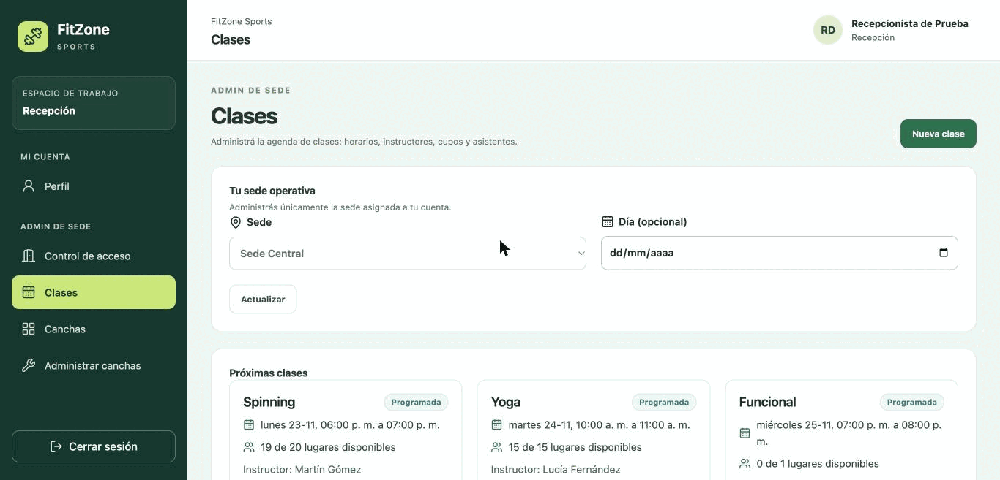

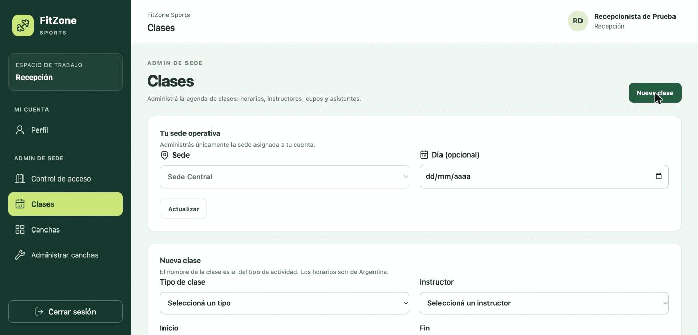

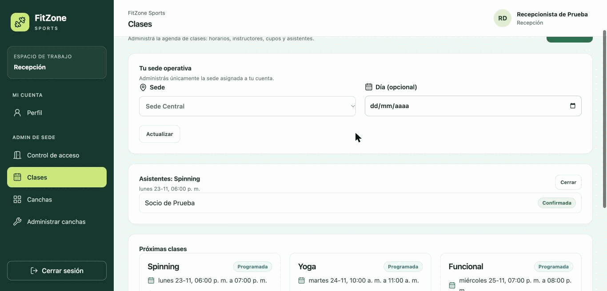

### 4.3 Inhabilitación de canchas por mantenimiento

**Disponibilidad.** Disponible desde el portal en **Administrar canchas**.  
**Objetivo.** Marcar una cancha temporalmente indisponible, publicar turnos nuevos o dar de alta una cancha.  
**Perfil.** Recepción de su sede o Gerencia.  
**Antes de empezar.** Identificá la cancha, el inicio del bloqueo, el motivo y, si se conoce, la hora de fin. Revisá si hay reservas que ocupan el intervalo.

1. Abrí **Administrar canchas**. En **Canchas registradas** elegí la cancha (el menú **Canchas** sólo la consulta). Para dar de alta una nueva, completá **Crear cancha** con su **Nombre** y **Tipo de cancha**. Marcá o desmarcá **Cancha activa para nuevas reservas** según corresponda.
2. Para ofrecer horarios, en **Crear turno** elegí **Fecha** y **Hora de inicio** y pulsá **Crear turno de 60 minutos**. El servidor valida que el turno sea futuro y del mismo día.
3. Para bloquear la cancha, en **Registrar mantenimiento** completá **Inicio**, **Fin (opcional)** y **Motivo** y pulsá **Registrar mantenimiento**.
4. Para levantar el bloqueo, buscalo en **Historial de mantenimientos** y pulsá **Desactivar**; confirmá el aviso. El registro se conserva como historial.

**Resultado esperado.** El bloqueo activo impide nuevas ocupaciones de los turnos que se superponen. Las reservas existentes se conservan.

**Si hay un problema.** Si hay una reserva confirmada o una retención que ocupa el intervalo, el bloqueo se rechaza: consultá las reservas y coordiná otro horario. El inicio no puede quedar en el pasado y un fin informado debe ser posterior al inicio. Si el recurso está en otra sede, pedí a Gerencia que lo gestione.

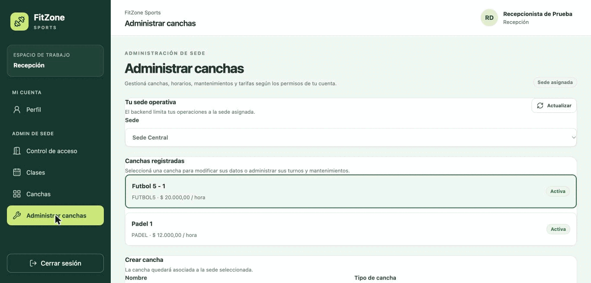

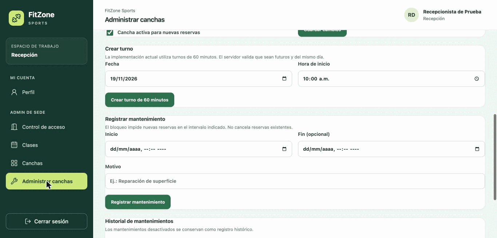

### 4.4 Problemas frecuentes

**Objetivo.** Identificar una incidencia del mostrador antes de repetir un movimiento.  
**Perfil.** Recepción de la sede.  
**Antes de empezar.** Ubicá el puesto, la hora y el resultado que muestra el portal. Tomá nota del mensaje sin divulgar el contenido del QR.

| Situación | Qué hacer y qué esperar |
| --- | --- |
| El QR venció, fue reemplazado o ya se usó | Pedí al socio que muestre **Mi QR** actualizado y volvé a escanear. Si el ingreso anterior sigue abierto, revisá **Movimientos recientes** antes de intentar otra entrada. |
| La salida falla | Pedí al socio un QR actualizado y escaneá de nuevo en modo **Salida**. Si la visita está asociada a otra sede, derivá la gestión a esa sede o a Gerencia. |
| La cámara no abre | Concedé el permiso de cámara al navegador y reintentá **Escanear QR**. Si no hay cámara disponible, usá otro equipo de la sede. |
| El aforo no cambia o indica **Sin actualizar** | Usá **Actualizar aforo** y verificá la hora del último dato. Contrastá con **Movimientos recientes**. Durante un corte, el aforo local es provisional. |
| El servidor está sin conexión | Si la copia sigue vigente, el terminal opera en contingencia. Conservá los movimientos pendientes hasta ver el resultado de sincronización. Si la copia venció, recuperá conexión antes de registrar otro movimiento. |
| El panel avisa un movimiento sin resultado verificado | Revisá **Movimientos recientes** y pulsá **Ya verifiqué el resultado** para continuar. |
| La pantalla indica conflicto o rechazo al sincronizar | Revisá el resultado del evento y comunicá el caso a la coordinación de sede. La interfaz actual carece de una operación de corrección administrativa de esos eventos. |

## 5. Manual del Gerente central

El Gerente administra **toda la cadena**. Su menú, bajo **Administración global**, incluye **Panel general**, **Planes**, **Sedes**, **Usuarios / Membresías**, **Reportes**, **Clases**, **Canchas** y **Administrar canchas**.

**Panel general.** Muestra cuántas **Sedes registradas** y **Usuarios registrados** hay (todas las cuentas, no sólo socios), el resultado de los **Últimos 30 días** (cobros, devoluciones, neto e ingresos) y una tabla con el aforo actual de cada sede. Usá **Actualizar resumen** para recargar.

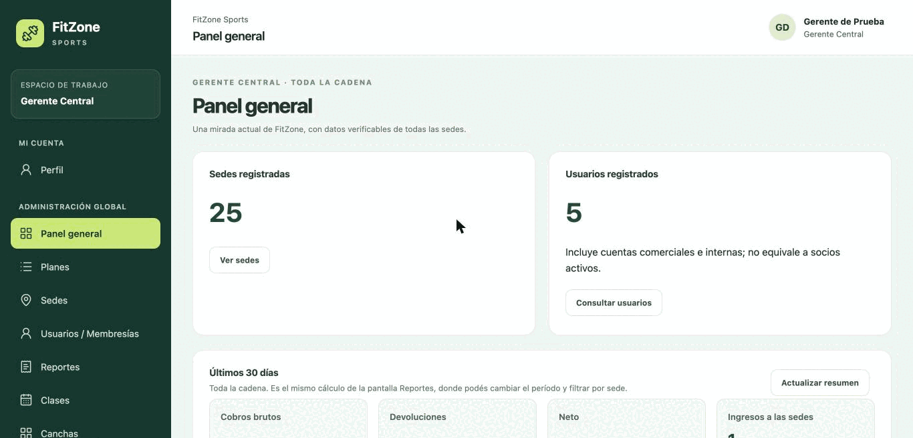

### 5.1 Alta y configuración de sedes

**Disponibilidad.** Disponible desde el portal.  
**Objetivo.** Crear una sede o modificar su nombre, dirección y capacidad.  
**Perfil.** Gerente central.  
**Antes de empezar.** Iniciá sesión como Gerente. Prepará el nombre, la dirección si corresponde y una capacidad máxima entera mayor que cero.

1. En el menú de administración global abrí **Sedes**.
2. En **Nueva sede**, completá **Nombre**, **Dirección** y **Capacidad máxima**. Pulsá **Guardar sede**.
3. Para modificar una sede, en **Todas las sedes** pulsá **Editar** junto al nombre. Actualizá los campos y guardá (o **Cancelar edición**).
4. Usá **Actualizar sedes** si el listado necesita recargarse.

**Resultado esperado.** La sede creada o editada aparece con sus datos actualizados y queda disponible de inmediato para usuarios, accesos, canchas, clases y para el filtro de **Reportes**. La edición conserva las asignaciones de usuarios existentes.

**Si hay un problema.** Comprobá el entero positivo de capacidad y el nombre obligatorio. No se admiten nombres de sede repetidos. Si se deniega la operación, verificá que estés en una cuenta de Gerencia. Si perdés la conexión al guardar, consultá el listado antes de volver a enviar.

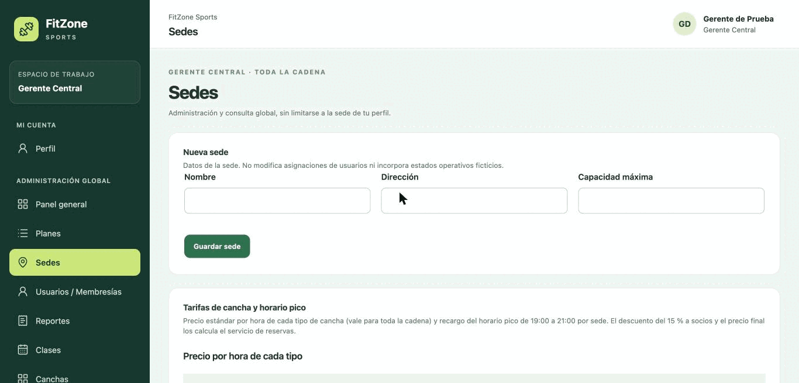

### 5.2 Configuración de precios, descuentos y horario pico

**Disponibilidad.** Disponible desde el portal: planes en **Planes**; tarifas por tipo de cancha y recargo pico por sede en **Sedes**. El descuento de socio (15 %) y la franja pico (19:00 a 21:00) están definidos por el sistema.  
**Objetivo.** Mantener los precios de los planes y las tarifas que se usan para cotizar canchas.  
**Perfil.** Gerente central.  
**Antes de empezar.** Prepará los importes en ARS, el plan o tipo de cancha y, para un recargo, la sede.

1. Para membresías, abrí **Planes**. En **Crear plan**, completá **Nombre**, **Duración** (1, 3 o 12 meses) y **Precio (ARS)**. Pulsá **Crear plan**.
2. Para ajustar uno existente, pulsá **Editar** en **Planes activos e inactivos**, revisá nombre, duración, precio y **Plan activo**, y usá **Guardar cambios**. El listado también ofrece **Desactivar** (con confirmación). La baja conserva el historial. Un precio nuevo se usa en operaciones posteriores.
3. Para canchas, abrí **Sedes** y bajá hasta **Tarifas de cancha y horario pico**. En **Precio por hora de cada tipo** pulsá **Editar** junto al tipo, cambiá el valor (mayor que cero) y guardá. Para sumar un tipo nuevo, completá su nombre y precio por hora.
4. Para el recargo, en **Recargo del horario pico por sede** elegí la **Sede**, escribí el **Nuevo recargo (%)** (de 0 a 100) y pulsá **Guardar recargo**. Una sede nueva arranca en 20 %.

**Resultado esperado.** Los planes reflejan el precio guardado. El precio final de un turno usa el tipo de cancha, el porcentaje de la sede y la parte del turno dentro de 19:00 a 21:00; luego se descuenta 15 % a socios con membresía vigente sobre el total con recargo. El precio queda guardado en cada reserva, así que cambiar una tarifa no altera reservas ya hechas.

**Cómo comprobar un cambio.** Entrá como socio en **Canchas** y mirá el precio de un turno. Ejemplo con Fútbol 5 a $ 20.000 y 20 % de recargo: 19:00–20:00 cuesta $ 24.000 y $ 20.400 para un socio; 17:00–18:00 cuesta $ 20.000 y $ 17.000 para un socio.

**Si hay un problema.** Validá un precio positivo, un plan activo y los valores admitidos. Si un tipo carece de tarifa, configurala antes de ofrecer turnos. Si el importe final difiere de lo previsto, revisá la sede, el horario y la vigencia de la membresía.

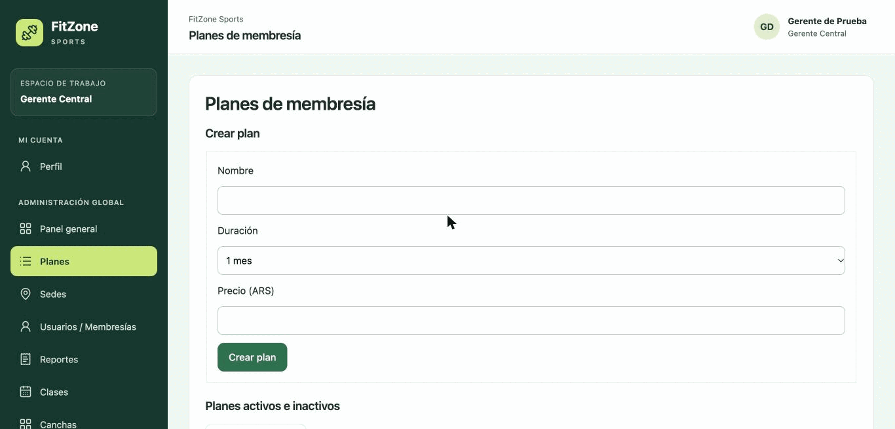

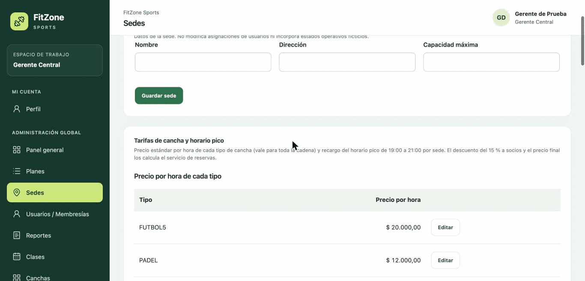

### 5.3 Reportes consolidados

**Disponibilidad.** Disponible desde el portal.  
**Objetivo.** Analizar cobros, devoluciones y accesos de toda la cadena o de una sede en un período.  
**Perfil.** Gerente central.  
**Antes de empezar.** Iniciá sesión como Gerente.

1. Abrí **Reportes**. Al entrar consulta automáticamente los últimos 30 días de toda la cadena.
2. Elegí **Desde**, **Hasta (incluido)** (ambos son días completos en hora argentina) y **Sede** (*Toda la cadena* o una sede). Los botones **Últimos 7 días**, **Últimos 30 días** y **Este mes** cargan períodos habituales. Pulsá **Consultar reportes**. El período no puede superar 366 días.
3. Leé **Cobros y devoluciones**: **Cobros brutos** (pagos aprobados del período, incluidos los que luego se devolvieron), **Devoluciones**, **Neto** (puede ser negativo) y **Pagos rechazados** (informativo, no suma importes). Debajo, **Evolución diaria** (barras de cobros y devoluciones por día), **Por sede** (con una fila **Total**; un cobro se atribuye a la sede de la membresía o de la cancha) y el desglose por concepto (**Membresías** y **Reservas de cancha**).
4. Leé **Accesos a las sedes**: **Ingresos**, **Personas distintas**, **Permanencia media** (sólo ingresos con salida) e **Ingresos sin salida**, con el pico simultáneo por sede respecto de su capacidad.

**Resultado esperado.** Cada bloque informa el período, el alcance y la hora en que se generó. **Aforo actual** (en **Panel general**) es la lectura de este momento; el reporte de accesos es histórico.

**Si hay un problema.** Si la fecha de inicio es posterior a la de fin o el período es demasiado largo, el portal avisa sin consultar. Si un bloque falla, aparece el mensaje y **Reintentar**, y el otro sigue visible. **Ver las N sedes sin movimientos** despliega el resto de la tabla por sede.

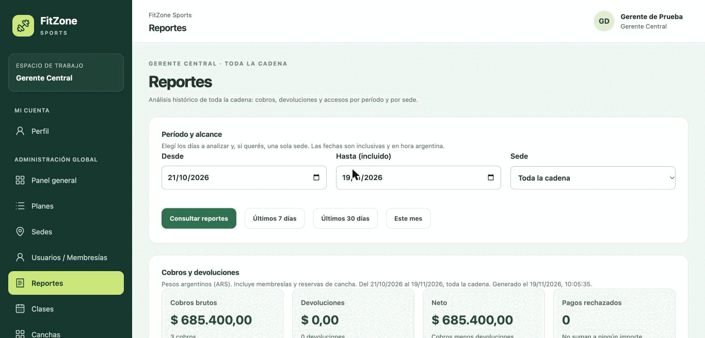

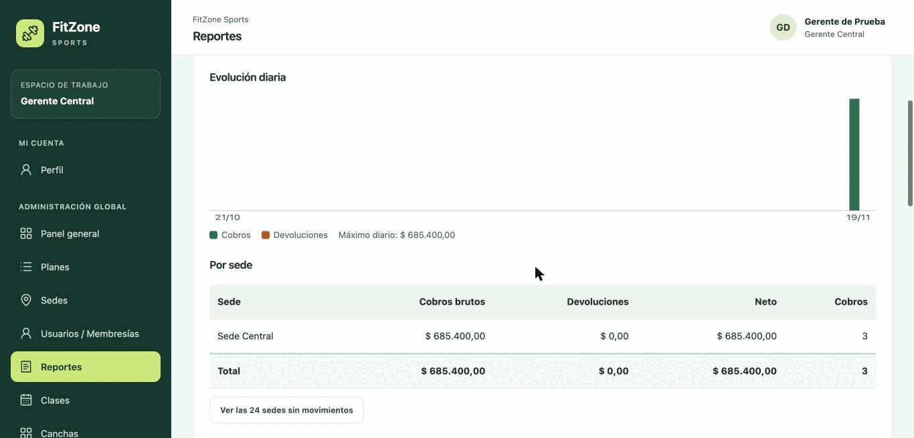

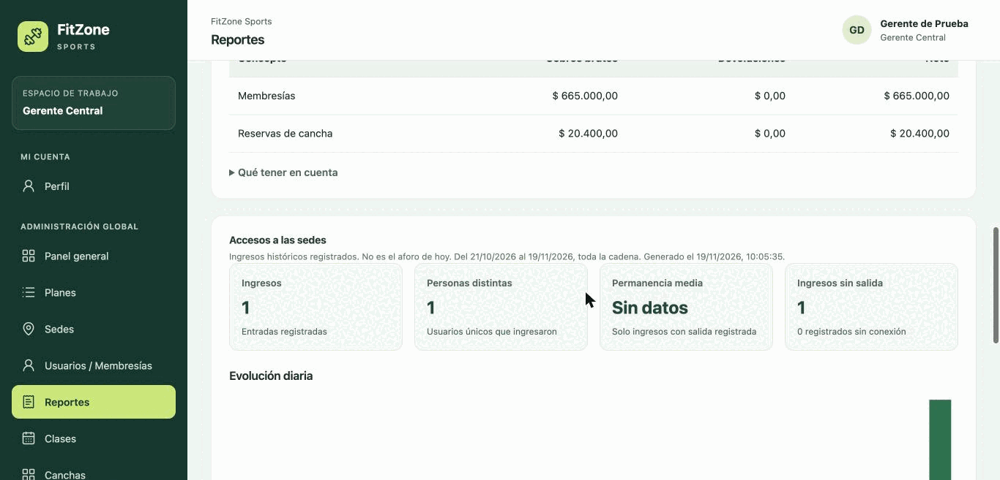

### 5.4 Usuarios y membresías

**Disponibilidad.** Disponible desde el portal.  
**Objetivo.** Buscar a una persona y consultar o actualizar su membresía.  
**Perfil.** Gerente central.  
**Antes de empezar.** Tené el nombre, email o DNI de la persona.

1. Abrí **Usuarios / Membresías**. En **Consulta global de usuarios** escribí en **Buscar nombre, email o DNI**. **Actualizar usuarios** recarga el listado.
2. En la fila de un socio o cliente pulsá **Ver membresía**. Se abre **Membresía de…** con el estado (por ejemplo **Activa**), el plan, el período vigente y los períodos registrados.
3. **Actualizar membresía** vuelve a consultar el dato; **Cerrar** oculta el detalle.

**Resultado esperado.** Ves la membresía de cualquier usuario sin limitarte a tu sede.

**Si hay un problema.** Si una cuenta no es socio ni cliente, no tiene membresía para consultar. Si falla la consulta, usá **Actualizar membresía**.

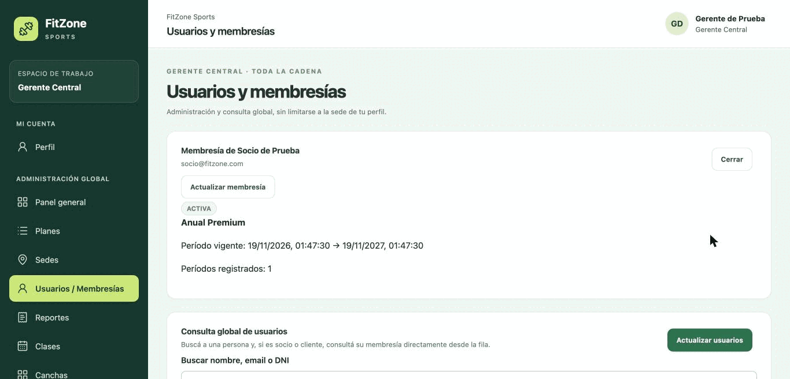

## 6. Preguntas frecuentes

**¿Puedo ir a otra sede con mi membresía?** Sí, con vigencia y cuenta activa. La sede habitual identifica tu cuenta. El acceso se registra en la sede visitada.

**¿Se efectuó un cargo en mi tarjeta?** En este sistema los cobros y devoluciones son simulados. Los recorridos descritos usan importes de demostración y no solicitan datos de tarjeta.

**¿Por qué no aparece Mi QR?** Revisá **Mi membresía**. El menú del Socio habilita esa opción con la membresía vigente.

**¿Puedo reservar una cancha sin ser socio?** Sí. Un cliente sin membresía puede reservar y pagar canchas; paga el precio estándar. El socio con membresía vigente recibe 15 % de descuento.

**¿Cuánto tiempo tengo para pagar un turno?** Hasta 10 minutos desde que elegís el turno, y nunca más allá de su comienzo. Pasado ese tiempo el turno se libera.

**¿La lista de espera confirma mi lugar?** La lista asigna una posición. Consultá **Mis reservas** y aceptá una oferta vigente si aparece.

**¿Se aplica una sanción por cancelar una clase tarde?** El sistema registra la cancelación tardía (menos de 2 horas) como falta en la respuesta. La sanción todavía está pendiente de implementación.

**¿Puedo descargar un comprobante reembolsado?** Sí, sigue disponible el PDF del cobro original. Consultá por separado el estado de la devolución.

**¿Qué hago si se corta Internet en Recepción?** Usá el terminal preparado durante su vigencia y conservá el perfil del navegador hasta confirmar la sincronización. El movimiento registrado localmente es provisional.

**¿Dónde se ven los reportes de ingresos y ocupación?** En **Reportes**, con la cuenta de Gerencia (sección 5.3).

## Fuentes y estado de las capturas

- Estructura de la guía contrastada con el Anexo D de los Lineamientos de Entrega del TIF. [Referencia normativa](../arquitectura-tif.md#referencia-normativa-y-alcance)
- Navegación, rótulos y visibilidad por rol contrastados con el portal en ejecución. Permisos y operaciones contrastados con controladores y OpenAPI. [Rutas React](../../frontend/src/routes/AppRoutes.jsx) · [Menú](../../frontend/src/components/Layout.jsx) · [OpenAPI](../openapi/openapi.yaml)
- Guías y evidencia funcional consultadas. [Registro y perfil](../rf01-rf02-experiencia-verificacion.md) · [Membresías](../membresias.md) · [Recepción](../m2-recepcion.md) · [Acceso offline](../m2-offline.md) · [Lista de espera](../diagramas/uml-actividad-lista-espera.md) · [Canchas y pagos](../canchas-pagos-backend.md) · [Integración M4/M5](../integracion-canchas-pagos.md) · [Pruebas](../pruebas.md)
- Para instalación y operación del entorno, consultá los otros manuales. [Manual de instalación y operación](manual-instalacion-operacion.md) · [Manual técnico](manual-tecnico.md)

**Capturas.** 31 capturas del portal en ejecución, tomadas el 19/11/2026 con la misma compilación y la misma instancia (`docker compose up --build -d`, perfil de desarrollo con datos de demostración), con las cuentas de Socio, Cliente, Recepción y Gerente. Los QR, nombres, correos y DNI que se ven son datos de demostración. No se incluye captura del Mi QR sin conexión (3.4) ni del terminal operando durante un corte (4.1), que requieren cortar la red del equipo; sus pasos se describen según el comportamiento del portal. La anulación de un período de membresía por arrepentimiento (3.7) se describe con sus fuentes porque no tiene pantalla en el portal.
