# FitZone Sports — Manual de usuario

| Versión | Fecha | Responsable de autoría |
| --- | --- | --- |
| 1.0 | 18/11/2026 | Pendiente de confirmación por el equipo |

Edición para el Trabajo Integrador Final. Alcance consultado en `main`, commit `8e0ba85`.

## Índice

- [1. Introducción](#introduccion)
- [2. Cómo utilizar este manual](#como-utilizar)
- [3. Manual del Socio](#socio)
  - [3.1 Registro y carga del perfil](#registro-perfil)
  - [3.2 Contratación y renovación de membresías](#membresias)
  - [3.3 Obtención del código QR y acceso al gimnasio](#qr)
  - [3.4 QR rechazado o sede sin conexión](#contingencia)
  - [3.5 Reserva de clases grupales y lista de espera](#reserva-clases)
  - [3.6 Reserva de canchas y cálculo del precio](#reserva-canchas)
  - [3.7 Cancelaciones, plazos y penalidades](#cancelaciones)
  - [3.8 Comprobantes de pago](#comprobantes)
- [4. Manual del Recepcionista / Administrador de sede](#recepcion)
  - [4.1 Validación de ingresos y control de aforo](#acceso-aforo)
  - [4.2 Gestión de agenda de clases](#agenda)
  - [4.3 Inhabilitación de canchas por mantenimiento](#mantenimiento)
  - [4.4 Problemas frecuentes](#problemas-mostrador)
- [5. Manual del Gerente central](#gerencia)
  - [5.1 Alta y configuración de sedes](#sedes)
  - [5.2 Configuración de precios, descuentos y horario pico](#precios)
  - [5.3 Reportes consolidados](#reportes)
- [6. Preguntas frecuentes](#preguntas)
- [Fuentes y estado de las capturas](#fuentes-capturas)

## 1. Introducción

FitZone Sports reúne en un portal la gestión de una cadena de gimnasios y canchas deportivas. Desde tu cuenta podés contratar una membresía, consultar su vigencia, mostrar una credencial QR, reservar clases y descargar comprobantes de membresía. Recepción opera el acceso y la agenda de su sede. Gerencia consulta la cadena y administra sedes, planes y agenda con alcance global.

La contratación, la renovación y el cobro de reservas usan una pasarela simulada. Los importes y las devoluciones que aparecen corresponden a operaciones de demostración.

## 2. Cómo utilizar este manual

Los nombres en **negrita** corresponden a opciones visibles en el portal. En una pantalla angosta, abrí el menú con el botón **Abrir menú de navegación**. El nombre o avatar del encabezado abre **Perfil**. Usá **Cerrar sesión** en un equipo compartido una vez finalizada la operación. Recepción debe conservar la sesión y el perfil del navegador mientras tenga movimientos offline pendientes.

| Disponibilidad | Qué podés hacer |
| --- | --- |
| **Disponible desde el portal** | Seguí los pasos indicados en la interfaz. |
| **Sólo por API** | La operación existe en el sistema. Pedí a personal autorizado que use la integración indicada con tu referencia de operación. |
| **Parcial** | Hay una pantalla o capacidad de consulta. El procedimiento aclara qué parte queda pendiente. |
| **No implementado** | La función todavía no produce un resultado utilizable. |

| Perfil | Inicio y alcance |
| --- | --- |
| **Socio / Cliente** | Empieza en **Mi membresía** o **Elegí tu plan**. Una cuenta con membresía vigente dispone de **Mi QR** y **Clases**. Una cuenta sin plan puede consultar el catálogo de **Canchas**. |
| **Recepción / Administración de sede** | Empieza en **Control de acceso**. Trabaja sobre la sede asignada a su cuenta. |
| **Gerente central** | Empieza en **Panel general**. Consulta y administra las sedes de la cadena según el permiso de cada operación. |

**Glosario.** Un *período* es el tramo contratado de un plan. La *sede habitual* es la referencia de tu cuenta. El *aforo* muestra cuántas personas tienen un ingreso abierto respecto de la capacidad de la sede. Una *retención* aparta temporalmente un turno de cancha mientras espera pago. Un *movimiento provisional* quedó guardado en el terminal offline y está sujeto a confirmación central. La *lista de espera* asigna una posición y puede generar una oferta de cupo. Las horas de las actividades se interpretan en hora argentina.

## 3. Manual del Socio

### 3.1 Registro y carga del perfil

**Disponibilidad.** Disponible desde el portal.  
**Objetivo.** Crear tu cuenta y actualizar el nombre, apellido o foto de perfil.  
**Perfil.** Persona que se registra. Las ediciones corresponden al titular de la cuenta.  
**Antes de empezar.** Tené tu DNI, correo, una contraseña de al menos 8 caracteres y una foto PNG o JPEG. La foto admite hasta 2 MB, 4096 píxeles por lado y 8 megapíxeles.

1. En el inicio de sesión, elegí **Registrarse**.
2. Completá **Nombre**, **Apellido**, **DNI**, **Email**, **Contraseña** y **Repetir contraseña**. Adjuntá la **Foto de perfil** y pulsá **Registrarme**.
3. Una vez dentro, abrí **Perfil** desde el nombre o avatar del encabezado.
4. Para cambiar tu nombre o apellido, elegí **Editar perfil** y luego **Guardar cambios**. Para cambiar la imagen, elegí otro archivo y pulsá **Guardar foto**.

**Resultado esperado.** Se inicia tu sesión y el portal te lleva a elegir un plan. Después de una edición, el nombre o la foto actualizados aparecen en **Perfil**. DNI, correo, rol y sede se conservan al editar el nombre. La sede habitual se confirma en la primera contratación.

**Si hay un problema.** Verificá que las contraseñas coincidan y que el archivo cumpla los límites. Si el correo o DNI ya está registrado, usá tu cuenta existente o consultá con administración. Si falla la carga del perfil, usá **Reintentar consulta del perfil**.

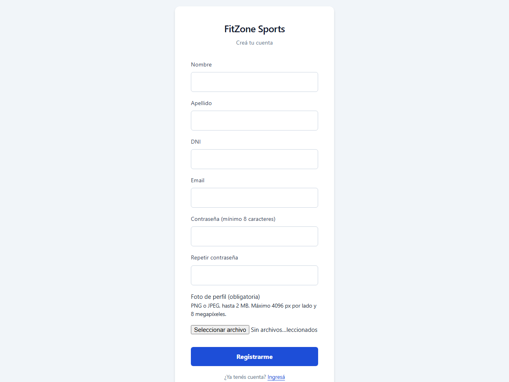

### 3.2 Contratación y renovación de membresías

**Disponibilidad.** Disponible desde el portal.  
**Objetivo.** Contratar un primer período o extender una membresía existente.  
**Perfil.** Titular de la cuenta comercial.  
**Antes de empezar.** Iniciá sesión con conexión. Debe haber un plan activo. El primer alta necesita una sede habitual.

1. Sin membresía, abrí **Elegí tu plan**, compará duración y precio y pulsá **Elegir este plan**.
2. Elegí la sede habitual si se solicita. Si tu cuenta ya tiene una sede guardada, el portal la conserva. Revisá el resumen y pulsá **Confirmar contratación**.
3. Si ya tenés una membresía, entrá en **Mi membresía**. El portal ofrece **Renovar plan** cuando el período vigente entra en sus últimos siete días y no hay continuidad programada ni renovación automática activa. Para una membresía vencida, muestra **Renovar membresía** cuando la operación está habilitada.
4. Elegí un plan activo, revisá el importe y pulsá **Confirmar renovación**. Cuando el bloque lo permita, podés usar **Habilitar renovación automática** o **Desactivar renovación automática**. La automática usa el último plan contratado y su precio vigente. Si la cuenta no tiene ningún período sin cancelar, primero renovalo de forma manual.

**Resultado esperado.** Si el pago simulado se aprueba, el período aparece en tu historial. Una renovación anticipada agrega el período a partir del fin del anterior. Si ya venció y no quedan períodos futuros, comienza desde la nueva contratación. Desactivar la automática conserva los períodos pagados.

**Si hay un problema.** Si el resultado quedó incierto, primero revisá **Mi membresía** y usá **Reintentar contratación** o **Reintentar renovación pendiente** cuando aparezcan. Eso conserva la misma operación. Si se rechazó el pago, revisá el aviso antes de volver a intentar. Si la cuenta está suspendida, consultá con administración. Si ya hay un período futuro, consultalo en **Mi membresía** antes de buscar una nueva renovación.

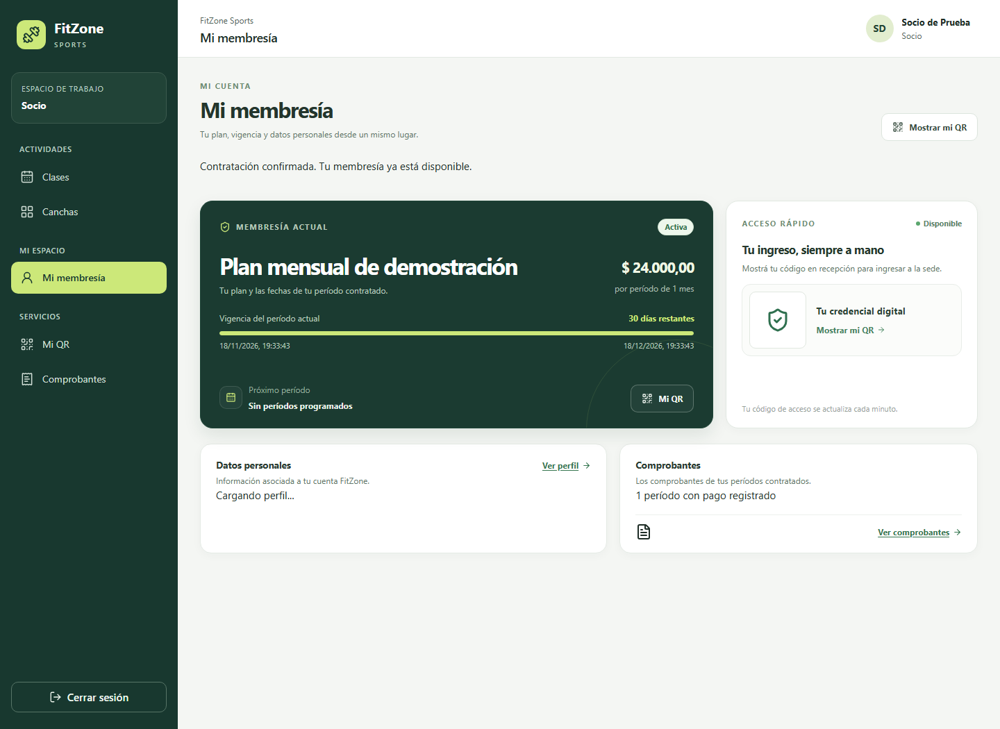

### 3.3 Obtención del código QR y acceso al gimnasio

**Disponibilidad.** Disponible desde el portal.  
**Objetivo.** Presentar una credencial vigente para ingresar al gimnasio.  
**Perfil.** Socio titular con cuenta activa y membresía vigente.  
**Antes de empezar.** Iniciá sesión. Abrí la credencial con conexión al menos una vez antes de depender del modo sin conexión.

1. Elegí **Mi QR** en el menú, o **Mostrar mi QR** desde **Mi membresía**.
2. Esperá a que aparezca la **Credencial Digital**. Mostrá el código vigente en Recepción.
3. Esperá la confirmación del ingreso. Para salir, seguí las indicaciones del mostrador y conservá el número de ingreso si se te informa.

**Resultado esperado.** Recepción valida el ingreso en la sede que estás visitando. El código es rotativo y puede cambiar cada minuto. Podés acceder a otras sedes con la misma membresía vigente.

**Si hay un problema.** Si no aparece **Mi QR**, revisá la vigencia y el estado en **Mi membresía**. Si el código fue reemplazado, venció o ya se usó, mostrá el que se ve en ese momento o esperá el siguiente. La sección [3.4](#contingencia) explica qué revisar si la sede perdió conexión.

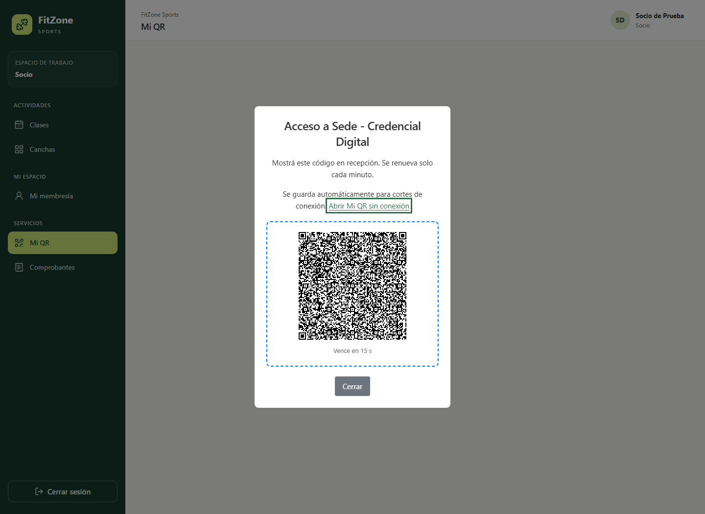

### 3.4 Qué hacer si el QR es rechazado o la sede está sin conexión

**Disponibilidad.** Disponible desde el portal y la PWA preparada.  
**Objetivo.** Resolver un rechazo o presentar una credencial durante un corte.  
**Perfil.** Socio titular. Recepción determina si puede validar el movimiento.  
**Antes de empezar.** Para acceder sin Internet propio necesitás la PWA preparada en el mismo navegador y una autorización vigente guardada al abrir **Mi QR** con conexión. Para aceptar durante un corte, la sede necesita su terminal previamente preparado.

1. Si te rechazan el QR, revisá que la cuenta y el período sigan vigentes. Mostrá el código actual. Si quedó un ingreso abierto, pedí a Recepción que revise el movimiento anterior.
2. Si Recepción perdió conexión y tu teléfono aún tiene Internet, abrí **Mi QR** de forma habitual y mostrá la credencial actual.
3. Si tu teléfono también está sin conexión, abrí la PWA guardada y usá **Abrir Mi QR sin conexión** desde la credencial o el acceso offline ya preparado.
4. Si el terminal admite la visita, esperá la indicación de Recepción. Registrará el movimiento como provisional y al reconectar lo enviará al sistema central.

**Resultado esperado.** La autorización guardada se puede usar dentro de su vigencia. El horizonte es de hasta dos horas y puede terminar antes si vence el período pagado. El ingreso provisional puede quedar confirmado o requerir revisión al sincronizar.

**Si hay un problema.** Si la pantalla indica que la autorización no existe o venció, buscá conexión y abrí **Mi QR**. Si el terminal está sin preparar o su copia venció, pedí a Recepción que recupere la conexión y la actualice. Un código previo o una captura guardada puede haber vencido. Si una membresía está suspendida o vencida, pedí la revisión de tu cuenta.

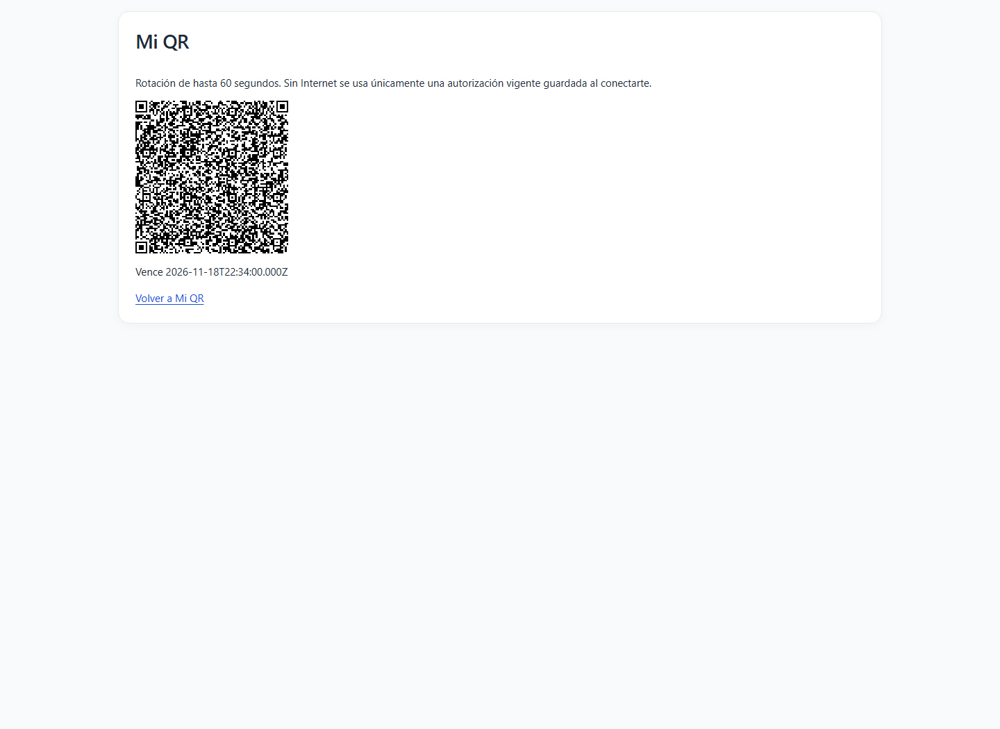

### 3.5 Reserva de clases grupales y lista de espera

**Disponibilidad.** Disponible desde el portal.  
**Objetivo.** Reservar una clase o anotarte para recibir una oferta de cupo.  
**Perfil.** Socio con membresía vigente. Gerencia también tiene permiso de reserva desde la agenda.  
**Antes de empezar.** Iniciá sesión y elegí una clase programada. La reserva directa y el alta en espera cierran 48 horas antes del comienzo.

1. Entrá en **Clases** y elegí **Sede** y **Día**. Usá **Actualizar** si el listado quedó viejo.
2. Si hay cupo, pulsá **Reservar**. Verificá el aviso de confirmación y buscá la clase en **Mis clases**.
3. Si la clase está llena y la inscripción sigue abierta, elegí **Anotarme en la lista de espera**. Consultá la posición en la ficha o en **Mis clases**.
4. Cuando aparezca una oferta, aceptala antes de la hora indicada con **Aceptar** o **Aceptar el lugar**. Para dejar pasar la oferta usá **Rechazar**. Para retirarte de la espera usá **Salir de la lista** o **Salir de la lista de espera**.

**Resultado esperado.** Una reserva confirmada o una posición en espera. Estar en la lista no garantiza un cupo. La oferta se consulta en el portal. El aviso externo se simula en el servidor.

**Si hay un problema.** Si el cupo desapareció, actualizá y revisá si podés entrar en espera. Una reserva en otra clase que se solapa puede impedir la confirmación. Si la oferta venció o cambió tu vigencia, revisá **Mis clases** y **Mi membresía**.

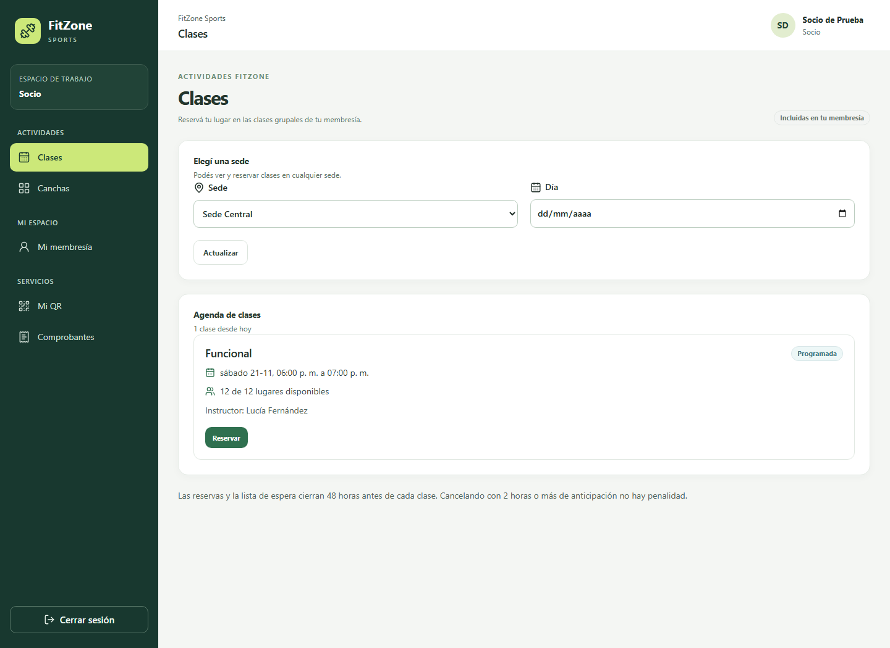

### 3.6 Reserva de canchas y cálculo del precio

**Disponibilidad.** Parcial. El portal muestra el catálogo. La disponibilidad por turno, cotización, retención y pago están disponibles sólo por API.  
**Objetivo.** Identificar la cancha y entender cómo se confirma un turno y su importe.  
**Perfil.** Socio o cliente con cuenta habilitada para reservar. El backend también autoriza a Gerencia.  
**Antes de empezar.** Iniciá sesión y definí sede, cancha y fecha deseadas. Para reservar, necesitás acceso autorizado al servicio de canchas y pagos.

1. En **Canchas**, elegí **Sede** y, si te ayuda, **Tipo de cancha**. Usá **Actualizar consulta** para volver a cargar el catálogo.
2. Identificá la cancha. Los pasos visuales **Fecha**, **Horario**, **Precio** y **Confirmación** de esta pantalla son orientativos. La pantalla actual no permite seleccionar un turno, retenerlo ni pagarlo.
3. Para seguir por el canal habilitado, solicitá la consulta de turnos y del precio del servidor. Pedí que se retenga el turno elegido y que se confirme el pago simulado antes de que venza la retención. La retención es de hasta 10 minutos en la configuración predeterminada y nunca pasa del inicio del turno. [Recorrido para el canal autorizado](../integracion-canchas-pagos.md#3-flujo-frontend-disponibilidad-reserva-y-pago)

**Resultado esperado.** La consulta muestra el catálogo en el portal. Por API, el turno queda confirmado únicamente con el pago simulado aprobado. El importe combina la tarifa del tipo de cancha y el recargo por el tramo que coincida con el horario pico de 19:00 a 21:00. A un socio con vigencia se le descuenta 15 % sobre ese total. El recargo depende de la sede. La aplicación calcula y conserva el precio de la reserva.

**Si hay un problema.** Si el turno se ocupó, está en mantenimiento o venció la retención, pedí una consulta actualizada antes de iniciar otra reserva. Si se rechazó el pago, se libera el turno y no se emite comprobante. Confirmá el estado de la operación original si la respuesta se perdió.

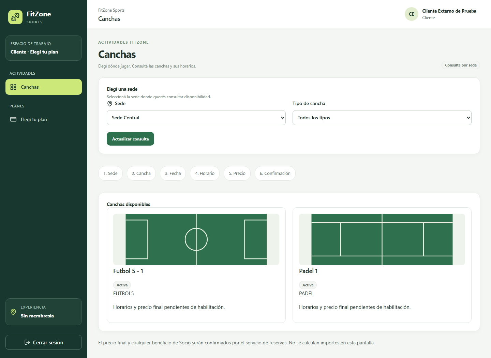

### 3.7 Cancelaciones, plazos y penalidades

Usá el procedimiento que corresponde al registro que querés cancelar. Si hubo un cobro simulado, revisá qué devolución permite el plazo de tu operación.

| Operación | Disponibilidad y perfil | Pasos, resultado y problemas |
| --- | --- | --- |
| **Cancelar una reserva de clase** | **Portal** para el socio titular mientras puede acceder a **Clases**. **API** para el titular aunque venza su membresía, Recepción de la sede o Gerencia. | **Antes:** Localizá una reserva confirmada antes del comienzo. Abrí **Clases** y usá **Cancelar mi reserva** en la ficha o **Cancelar reserva** en **Mis clases**. Confirmá el aviso. Se libera el cupo. Con 2 horas o más se registra como cancelación a tiempo. Con menos de 2 horas se registra tardía y cuenta como falta en la respuesta. La sanción por esa falta todavía no se aplica. Si **Clases** dejó de aparecer al vencer tu membresía, pedí ayuda a Recepción. Una clase iniciada ya no admite cancelación individual. |
| **Cancelar una reserva de cancha** | **Sólo por API.** Titular, Recepción de la sede o Gerencia. | **Antes:** Tené la referencia de la reserva y verificá que el turno aún no comenzó. Pedí su cancelación por el canal autorizado. Si todavía estaba retenida y sin pago, se libera sin devolución. Con pago aprobado, por defecto se devuelve 100 % con 2 horas o más de anticipación y 50 % con menos de 2 horas. Sólo Gerencia puede elegir explícitamente 50 % o 100 % en la cancelación administrativa. Si ya empezó el turno, la operación se rechaza. [Política de cancha](../canchas-pagos-backend.md#reglas-operativas) |
| **Cancelar un período de membresía por arrepentimiento** | **Sólo por API.** Titular o Gerencia. | **Antes:** Identificá el período con un pago registrado. Pedí la cancelación antes de que se cumplan 24 horas desde el cobro. Se registra una devolución total, se desactiva la renovación automática y se conservan los demás períodos. Si el plazo venció o el período histórico carece de pago vinculado, consultá con administración. [Condiciones del período](../membresias.md#arrepentimiento) |

### 3.8 Comprobantes de pago

**Disponibilidad.** Portal para comprobantes de períodos de membresía. El comprobante de un pago de cancha aprobado está disponible sólo por API.  
**Objetivo.** Descargar el PDF de un pago aprobado.  
**Perfil.** Titular de la cuenta en el portal. Por API la descarga corresponde al titular o a Gerencia.  
**Antes de empezar.** Iniciá sesión y localizá el período pagado o la referencia del pago de cancha.

1. Para una membresía, abrí **Comprobantes** y buscá el período. Se muestran primero los períodos más recientes entre los que tienen pago registrado.
2. Pulsá **Descargar PDF** y abrí el archivo desde las descargas del navegador.
3. Para un pago de cancha, solicitá el comprobante por el canal autorizado usando la referencia del pago.

**Resultado esperado.** Obtenés el PDF original del cobro simulado. El documento se conserva aunque se reembolse el pago. Un período cancelado y el PDF original por sí solos no indican el estado de una devolución.

**Si hay un problema.** Si no aparece **Comprobantes**, verificá que tu cuenta tenga al menos un período con un pago registrado. Si falla la consulta, usá **Reintentar consulta**. Si aparece un error de permiso, verificá la cuenta y la referencia. Los pagos rechazados carecen de PDF.

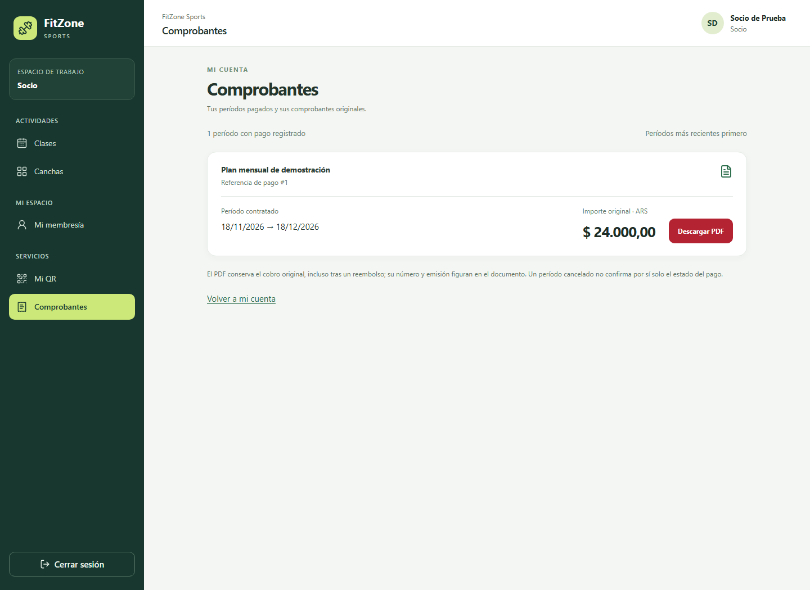

## 4. Manual del Recepcionista / Administrador de sede

### 4.1 Validación de ingresos y control de aforo

**Disponibilidad.** Disponible desde el portal. Contingencia disponible en la PWA con el terminal preparado.  
**Objetivo.** Registrar entradas y salidas y verificar cuántas personas hay en la sede.  
**Perfil.** Recepción opera su sede asignada. Gerencia consulta el aforo en su panel y puede registrar movimientos online sólo por API. La preparación y sincronización del terminal offline corresponden a Recepción.  
**Antes de empezar.** Iniciá sesión con tu cuenta de personal y verificá **Sede actual**. Prepará el lector 2D si lo usás. También podés pegar el contenido completo de un QR vigente.

1. Abrí **Control de acceso**. Para una entrada, elegí **Ingreso**, escaneá en **Contenido del código QR** o pegá el contenido, y pulsá **Validar ingreso**.
2. Leé la confirmación antes de admitir a la persona. Conservá el número **Ingreso #…** si necesitás identificar la salida.
3. Para un egreso, elegí **Salida** y seleccioná **Código QR vigente** o **Número de ingreso**. Ingresá el dato y pulsá **Registrar salida**. El número de ingreso sirve aunque la membresía o el QR hayan vencido.
4. Revisá **Aforo actual** en el puesto o abrí **Aforo**. Compará personas dentro y capacidad máxima. El portal refresca el dato cada 15 segundos y permite usar **Actualizar aforo**. El indicador es informativo y no bloquea los movimientos online.

**Resultado esperado.** Recepción obtiene un resultado para ingreso o salida. Un ingreso abierto suma al aforo de esa sede y su cierre lo resta. Si no pudo actualizarse, la tarjeta puede conservar el último dato disponible.

**Si hay un problema.** Si no hay sede asignada, pedí a Gerencia que revise la cuenta. Si el sistema informa un ingreso abierto o un QR vencido, verificá la visita antes de repetir el movimiento. Si el aforo quedó sin actualizar, usá **Reintentar aforo**.

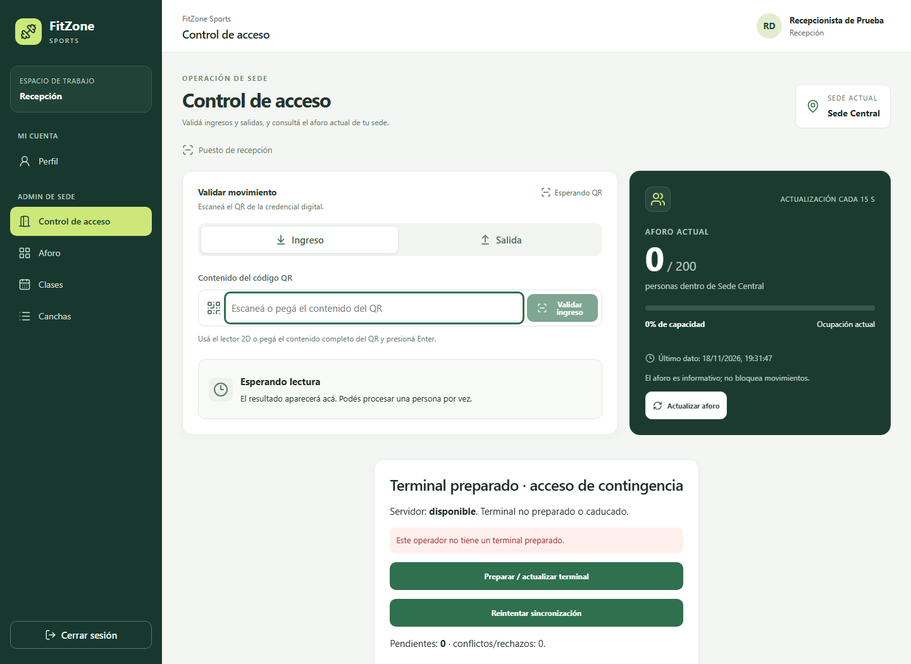

#### Preparar el terminal y trabajar durante un corte

**Disponibilidad.** Disponible en la PWA preparada.  
**Objetivo.** Conservar el control de ingresos y salidas cuando la sede no alcanza al servidor.  
**Perfil.** Recepción de la sede.  
**Antes de empezar.** Usá el equipo y perfil del navegador asignados. Con conexión y sesión válida, entrá en **Control de acceso**. La PWA debe haber quedado disponible en el equipo antes del corte.

1. En **Terminal preparado · acceso de contingencia**, elegí **Preparar / actualizar terminal**. Verificá la sede y la hora de vencimiento de la copia. La autorización dura hasta dos horas.
2. Al perder la conexión, usá **Abrir terminal sin conexión**. Elegí **Ingreso** o **Egreso**, ingresá el **QR de acceso** o el identificador que corresponda para un egreso, y pulsá **Registrar movimiento preparado**.
3. Revisá **Pendientes** y el **Aforo local provisional**. Al recuperar la conexión, esperá la sincronización o usá **Reintentar sincronización**. Revisá los resultados y los conflictos o rechazos antes de considerar cerrado el movimiento.

**Resultado esperado.** Los movimientos locales quedan guardados hasta recibir respuesta central. El aforo provisional puede diferir del central. Un conflicto requiere revisión y conserva la evidencia de lo ocurrido durante el corte.

**Si hay un problema.** Si la copia venció, recuperá la conexión y actualizala cuando no haya movimientos pendientes. Si la sesión expiró, recuperá la sesión con la misma cuenta y perfil del navegador. Mientras haya movimientos pendientes, conservá el perfil, los datos del navegador y la cola. Si aparecen conflictos, escalalos a la coordinación de la sede.

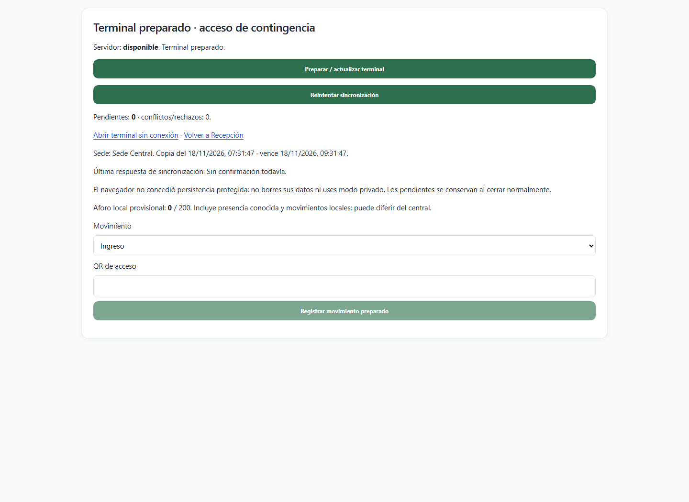

### 4.2 Gestión de agenda de clases

**Disponibilidad.** Disponible desde el portal para crear, editar, cancelar y ver reservas. El registro de asistencia todavía no está implementado.  
**Objetivo.** Programar clases, ajustar su agenda y consultar la lista de reservas.  
**Perfil.** Recepción de la sede asignada y Gerencia para cualquier sede.  
**Antes de empezar.** Tené tipo de clase, instructor, fechas y horas de inicio y fin y cupo. Verificá que el instructor esté disponible para ese horario.

1. Abrí **Clases**. En Recepción la sede está fija. Si sos Gerencia, elegí la sede. Usá el filtro **Día** para revisar una fecha.
2. Pulsá **Nueva clase**. Elegí **Tipo de clase** e **Instructor**, completá **Inicio**, **Fin** y **Cupo (lugares)**. Si falta un tipo o instructor, el formulario ofrece **Agregar tipo** y **Agregar instructor**. Pulsá **Crear clase**.
3. Para modificar una clase programada, abrí su ficha, pulsá **Editar** y guardá con **Guardar cambios**. Para consultar reservas, usá **Ver asistentes**.
4. Para cancelar la clase completa, elegí **Cancelar clase**, escribí el motivo y pulsá **Confirmar cancelación**. Se cancelan las reservas confirmadas y se cierra la espera. La cancelación de toda la clase no registra faltas para sus asistentes.

**Resultado esperado.** La clase aparece en la agenda de la sede y del día correspondiente, con el horario, el cupo o estado actualizado. **Ver asistentes** muestra las reservas, no sirve para marcar presencia.

**Si hay un problema.** Revisá que el fin sea posterior al inicio y que el instructor no esté asignado a otra clase en ese horario. El sistema puede rechazar la reducción de cupo si ya hay lugares comprometidos. Si no ves la clase después de guardar, comprobá la sede y el filtro de día y usá **Actualizar**.

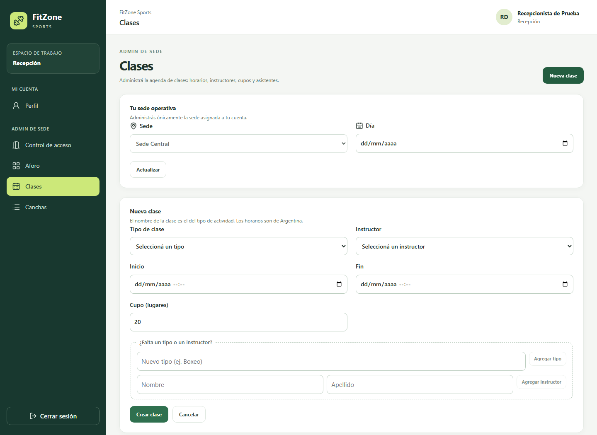

### 4.3 Inhabilitación de canchas por mantenimiento

**Disponibilidad.** Sólo por API para crear, consultar y retirar un bloqueo. **Canchas** permite consultar el catálogo de la sede desde el portal.  
**Objetivo.** Marcar una cancha temporalmente indisponible y comunicar el intervalo.  
**Perfil.** Recepción de su sede o Gerencia.  
**Antes de empezar.** Identificá la cancha, el inicio del bloqueo, el motivo y, si se conoce, la hora de fin. Revisá si hay reservas que ocupan el intervalo.

1. Si sos de Recepción, localizá el recurso de tu sede en **Canchas**. Si sos de Gerencia, pedí el catálogo de la sede por el canal autorizado. Los bloqueos se gestionan por API.
2. Pedí al operador que tenga acceso por API que registre el mantenimiento de esa cancha con inicio, fin opcional y motivo. La guía de integración identifica las operaciones para consultar o retirar un bloqueo. [Operación de mantenimiento por API](../integracion-canchas-pagos.md#5-administración-de-canchas-y-tarifas)
3. Verificá por ese mismo canal que el bloqueo esté activo y que los turnos de la franja ya no se ofrezcan para reservar.

**Resultado esperado.** El bloqueo activo impide nuevas ocupaciones de los turnos que se superponen. Las reservas existentes se conservan.

**Si hay un problema.** Si hay una reserva confirmada o una retención que ocupa el intervalo, el bloqueo se rechaza. Consultá las reservas y coordiná otro horario. El inicio no puede quedar en el pasado y un fin informado debe ser posterior al inicio. Si el recurso está en otra sede, pedí a Gerencia que lo gestione.

### 4.4 Problemas frecuentes

**Objetivo.** Identificar una incidencia del mostrador antes de repetir un movimiento.  
**Perfil.** Recepción de la sede.  
**Antes de empezar.** Ubicá el puesto, la hora y el número de ingreso o referencia que muestra el portal. Tomá nota del mensaje sin divulgar el contenido del QR.

| Situación | Qué hacer y qué esperar |
| --- | --- |
| El QR venció, fue reemplazado o ya se usó | Pedí al socio que muestre **Mi QR** actualizado. Si el ingreso anterior sigue abierto, verificá el número y la sede antes de intentar registrar otra entrada. |
| La salida falla con el QR | En **Salida**, elegí **Número de ingreso** y usá el identificador original. Si la visita está asociada a otra sede, derivá la gestión a esa sede o a Gerencia. |
| El aforo no cambia o indica **Sin actualizar** | Usá **Reintentar aforo** y verificá la hora del último dato. Contrastá con el resultado del movimiento. Durante un corte, el aforo local es provisional. |
| El servidor está sin conexión | Si la copia sigue vigente, abrí el terminal de contingencia. Conservá los movimientos pendientes hasta ver el resultado de sincronización. Si la copia venció, recuperá conexión antes de registrar otro movimiento. |
| La pantalla indica conflicto o rechazo al sincronizar | Revisá el resultado del evento y comunicá el caso a la coordinación de sede. La interfaz actual carece de una operación de corrección administrativa de esos eventos. |

## 5. Manual del Gerente central

### 5.1 Alta y configuración de sedes

**Disponibilidad.** Disponible desde el portal.  
**Objetivo.** Crear una sede o modificar su nombre, dirección y capacidad.  
**Perfil.** Gerente central.  
**Antes de empezar.** Iniciá sesión como Gerente. Prepará el nombre, la dirección si corresponde y una capacidad máxima entera mayor que cero.

1. En el menú de administración global abrí **Sedes**.
2. En **Nueva sede**, completá **Nombre**, **Dirección** y **Capacidad máxima**. Pulsá **Guardar sede**.
3. Para modificar una sede, en **Todas las sedes** pulsá **Editar** junto al nombre. Actualizá los campos y guardá.
4. Usá **Actualizar sedes** si el listado necesita recargarse.

**Resultado esperado.** La sede creada o editada aparece con sus datos actualizados. La edición conserva las asignaciones de usuarios existentes.

**Si hay un problema.** Comprobá el entero positivo de capacidad y el nombre obligatorio. Si falta **Sedes** en el menú o se deniega la operación, verificá que estés en una cuenta de Gerencia. Si perdés la conexión al guardar, consultá el listado antes de volver a enviar.

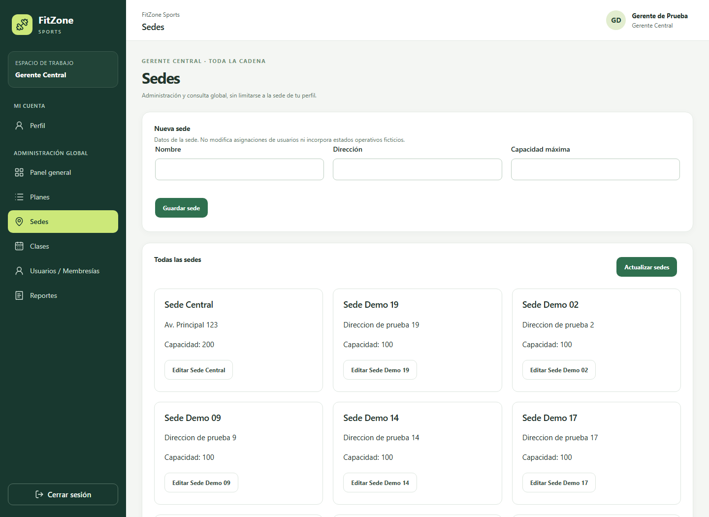

### 5.2 Configuración de precios, descuentos y horario pico

**Disponibilidad.** Portal para planes de membresía. Sólo por API para tarifas de cancha y recargo pico. El descuento de socio y la franja pico están definidos por el sistema.  
**Objetivo.** Mantener los precios de los planes y las tarifas que se usan para cotizar canchas.  
**Perfil.** Gerente central.  
**Antes de empezar.** Prepará los importes en ARS, el plan o tipo de cancha y, para un recargo, la sede.

1. Para membresías, abrí **Planes**. En **Crear plan**, completá **Nombre**, **Duración** (1, 3 o 12 meses) y **Precio (ARS)**. Pulsá **Crear plan**.
2. Para ajustar uno existente, pulsá **Editar**, revisá nombre, duración, precio y **Plan activo**, y usá **Guardar cambios**. El listado también ofrece **Desactivar** y pide **Confirmar desactivación**. La baja conserva el historial. Un precio nuevo se usa en operaciones posteriores.
3. Para canchas, solicitá por el canal habilitado un alta o cambio de precio por tipo y la configuración de **recargo pico** por sede, de 0 a 100 %. Al editar un tipo por API se informa su nombre y precio completo. Pedí una cotización de prueba del turno para comprobar el cambio. [Operaciones de configuración](../integracion-canchas-pagos.md#5-administración-de-canchas-y-tarifas)

**Resultado esperado.** Los planes reflejan el precio guardado. El precio final de un turno usa el tipo de cancha, el porcentaje de la sede y la parte del turno dentro de 19:00 a 21:00. La aplicación descuenta 15 % a socios con membresía vigente sobre el total con recargo. Esa franja y ese porcentaje no tienen controles de edición en la interfaz. [Reglas operativas de canchas](../canchas-pagos-backend.md#reglas-operativas)

**Si hay un problema.** Validá un precio positivo, un plan activo y los valores admitidos. Si el servicio informa que el tipo carece de tarifa, pedí configurarla antes de ofrecer turnos. Si el importe final difiere de lo previsto, volvé a consultar la cotización con la sede, el turno y la vigencia correctos.

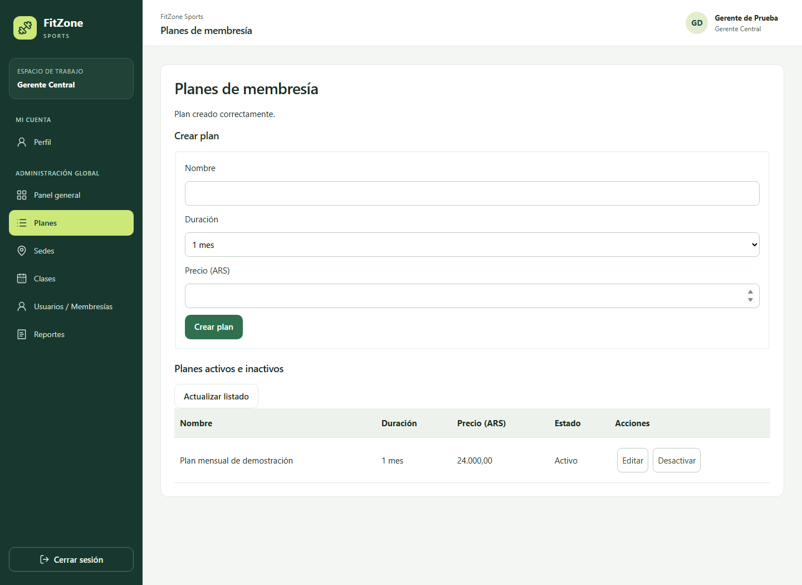

### 5.3 Reportes consolidados

**Disponibilidad.** Parcial. **Panel general** muestra datos actuales. **Reportes** tiene filtros, pero los reportes históricos de ocupación e ingresos no están implementados.  
**Objetivo.** Consultar datos actuales y reconocer el alcance de los informes.  
**Perfil.** Gerente central.  
**Antes de empezar.** Iniciá sesión como Gerente. Para consultar la pantalla de reportes, definí un período y el alcance de sedes.

1. En **Panel general**, revisá **Sedes registradas**, **Usuarios registrados** y **Estado actual por sede**. Usá **Actualizar panorama** o **Actualizar aforo de…** en la sede correspondiente. El total de usuarios registrados incluye cuentas internas y comerciales.
2. Para consultar la disponibilidad de un informe, abrí **Reportes**, elegí **Desde**, **Hasta (sin incluir)**, **Sede** y **Tipo**, y pulsá **Consultar reporte**.

**Resultado esperado.** El panel muestra lecturas actuales por sede. Los filtros del informe llevan a un aviso de disponibilidad pendiente, sin cifras históricas consolidadas, series ni recaudación calculada.

**Si hay un problema.** Primero verificá fechas y permisos. Si el portal indica que el servicio de reportes está pendiente, usá **Panel general** para revisar el estado actual. El aforo presente corresponde a una lectura de ocupación, no a un informe histórico ni financiero.

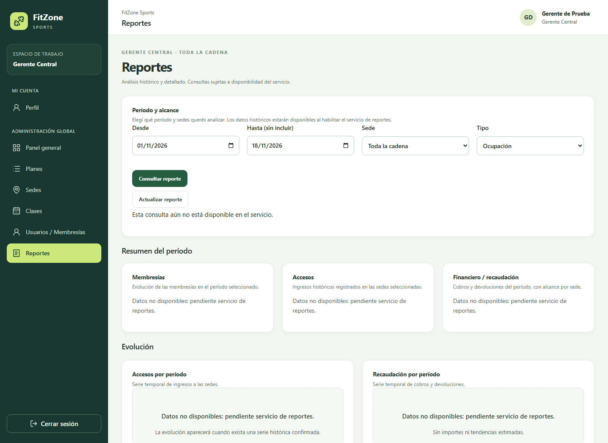

## 6. Preguntas frecuentes

**¿Puedo ir a otra sede con mi membresía?** Sí, con vigencia y cuenta activa. La sede habitual identifica tu cuenta. El acceso se registra en la sede visitada.

**¿Se efectuó un cargo en mi tarjeta?** En este sistema los cobros y devoluciones son simulados. Los recorridos descritos usan importes de demostración y no solicitan datos de tarjeta.

**¿Por qué no aparece Mi QR o Clases?** Revisá **Mi membresía**. El menú del Socio habilita esas opciones con la vigencia requerida.

**¿Puedo reservar una cancha desde el menú Canchas?** Podés consultar el catálogo por sede. Para elegir un turno, retenerlo, pagarlo o cancelarlo se usa el canal autorizado por API.

**¿La lista de espera confirma mi lugar?** La lista asigna una posición. Consultá **Mis clases** y aceptá una oferta vigente si aparece.

**¿Se aplica una sanción por cancelar una clase tarde?** El sistema registra la cancelación tardía como falta en la respuesta. La sanción todavía está pendiente de implementación.

**¿Puedo descargar un comprobante reembolsado?** Sí, sigue disponible el PDF del cobro original cuando la cuenta tiene permiso. Consultá por separado el estado de la devolución.

**¿Qué hago si se corta Internet en Recepción?** Usá el terminal preparado durante su vigencia y conservá el perfil del navegador hasta confirmar la sincronización. El movimiento registrado localmente es provisional.

## Fuentes y estado de las capturas

- Estructura de la guía contrastada con el Anexo D de los Lineamientos de Entrega del TIF, p. 21 de la edición de 25 páginas. [Referencia normativa](../arquitectura-tif.md#referencia-normativa-y-alcance)
- Navegación, rótulos y visibilidad por rol contrastados con el portal. Permisos y operaciones contrastados con controladores y OpenAPI. [Rutas React](../../frontend/src/routes/AppRoutes.jsx) · [Menú](../../frontend/src/components/Layout.jsx) · [OpenAPI](../openapi/openapi.yaml)
- Guías y evidencia funcional consultadas. [Registro y perfil](../rf01-rf02-experiencia-verificacion.md) · [Membresías](../membresias.md) · [Recepción](../m2-recepcion.md) · [Acceso offline](../m2-offline.md) · [Lista de espera](../diagramas/uml-actividad-lista-espera.md) · [Canchas y pagos](../canchas-pagos-backend.md) · [Integración M4/M5](../integracion-canchas-pagos.md) · [Gerencia](../gerencia-central-frontend.md) · [Pruebas](../pruebas.md)
- Para instalación y operación del entorno, consultá los otros manuales. Para el alcance actual de canchas y pagos, usá las guías M4/M5 de esta edición. [Manual de instalación y operación](manual-instalacion-operacion.md) · [Manual técnico](manual-tecnico.md)

**Capturas.** 13 incorporadas y 0 pendientes. Capturas del portal en ejecución desde el commit indicado, con cuentas y datos de demostración de una instancia local aislada. Los QR que se ven corresponden a la instancia de demostración.

La reserva, el pago y el mantenimiento de canchas y la configuración de sus tarifas se describen con sus fuentes, ya que esas operaciones carecen de pantalla en el portal.
