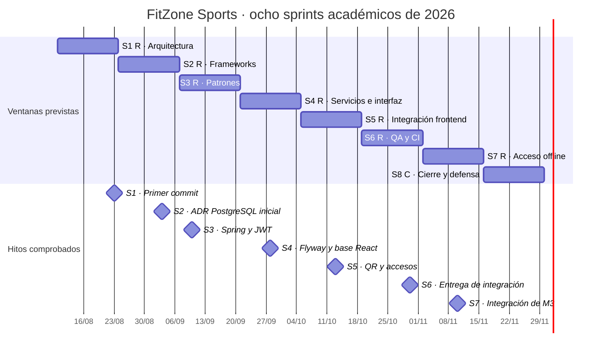

# Planificación y seguimiento del TIF de FitZone Sports

**Grupo consignado en los planes:** 2 · **Versión:** 0.3 · **Fecha de consolidación:** 11/11/2026\
**Corte Git:** `docs/cierre-tif`, `7c554b8705f4f5e3a2c5a59006e4195d41acd3c9`.

El seguimiento para el §5.6 y el Anexo H de los lineamientos se construye con los planes históricos para el trabajo previsto y con los commits, entregables y documentación versionada para el avance acreditado. Las bitácoras individuales aportan contexto, fechas declaradas y horas registradas. Su revisión queda a cargo de cada integrante. La consolidación avanza con las fuentes disponibles. **PC** significa pendiente de confirmación.

## 1. Alcance y restricciones

El alcance del TIF comprende usuarios y membresías, acceso y aforo con contingencia offline, clases y lista de espera, reservas de canchas y pagos con comprobantes. La entrega incluye integración, pruebas, documentación, seguimiento y defensa. El desglose de este archivo se puede usar para rastrear las tareas del cierre. Las claves de historia se asignaron durante esta consolidación y falta vincularlas con las tarjetas originales. [N1, N2]

Para el corte revisado quedan fuera de la operación acreditada el cobro real con tarjetas y la entrega externa de notificaciones de M3. El portal responsive y el terminal de sede son el alcance de operación descrito por los lineamientos de entrega. El enunciado también menciona un APK/IPA entre sus entregables por unidad. La interpretación aplicable debe confirmarse con la cátedra. Los pendientes de M4/M5, penalidades y reportes siguen identificados como brechas y requieren acuerdo de cierre. [N1 pp. 4 y 11–12, N2 p. 20, V1]

La planificación oficial de referencia abarca 16 semanas. Para el cierre se toma como límite de trabajo el **19/11/2026 a las 18:00 de Argentina**, horario de portada, §2.1 y §3.1. La tabla de hitos de pp. 4–5 indica 23:59. La diferencia queda pendiente de confirmación. La propuesta interna del 09/11 plantea llegar al 15/11 y conserva su carácter de propuesta. [N1, P09]

## 2. Equipo y distribución documentada

Los planes de períodos 3 y 4 nombran a los seis integrantes y la bitácora grupal registra aportes de los seis. Las tareas de la tabla se atribuyen únicamente al plan o registro que las identifica. Los roles académicos P1–P4 del modelo oficial, su correspondencia con los seis integrantes y las horas comprometidas **por persona** quedan PC. [P3, P4, B0, V1]

| Integrante verificado | Asignaciones que figuran en los planes | Trabajo registrado y fuente |
| --- | --- | --- |
| **Magalí Castell Ziegler** | Líder del período 3. Arquitectura con Valentina y API con Ignacio. En período 4, arquitectura/API y patrones con Augusto. [P3, P4] | Revisión de módulos y C4, reorganización del tablero, elaboración del plan del período 3 y revisión del dossier en el cierre. [B1, H03, H04, H10] |
| **Valentina Martínez** | Arquitectura y backend en período 3. Arquitectura, M2/M4 y apoyo a persistencia en período 4. [P3, P4] | Preparó la planificación del período 2, trabajó la definición de módulos y registró el traspaso de liderazgo del 27/09. [B4, H02, H03] |
| **Ignacio Denis** | Contratos con Magalí y frontend con Augusto en período 3. Líder del período 4, con contratos y frontend. [P3, P4] | Investigación de concurrencia, enfoque Design First y base React/sesión. [B3, H02, H05] |
| **Bautista Orge Perilli** | Persistencia en ambos períodos. En período 4, M1/M3 y reportes iniciales, con tareas semanales de persistencia y pagos. [P3, P4] | Flyway, endpoints iniciales, planes, membresías y PDF/reembolso de membresías. [B5, H04, H05, H06] |
| **Claudio Cejas** | Backend y seguridad en período 3. En período 4, M5 en la tabla por áreas y trabajo en acceso/canchas con Valentina en la semana 2. [P3, P4] | Autenticación, usuarios, sedes, QR/aforo y clases con espera. [B2, H02, H05, H06, H09] |
| **Augusto Vidoni** | Frontend e integración en período 3. Frontend y patrones en período 4. El registro grupal lo identifica como líder inicial el 26/08. [P3, P4, B0] | Navegación, contrato OpenAPI, integración M1 y verificación de M2 online/offline. [B6, H01, H05, H07, H08, H09] |

## 3. Desglose del trabajo

WBS consolidada a partir del enunciado, los planes y el alcance verificable. Las subtareas y criterios indican cómo comprobar el resultado. Las estimaciones históricas disponibles se conservan por bloque en [seguimiento](#5-seguimiento-de-capacidad-esfuerzo-y-desvíos). La estimación por historia/subtarea, los IDs del tablero y las asignaciones ausentes quedan PC.

| Épica | Historia o entrega y subtareas técnicas | Criterio de aceptación verificable | Asignación documentada |
| --- | --- | --- | --- |
| Arquitectura | **AR-01** Documentar contexto, contenedores, componentes y decisiones. Contrastar dependencias, mantener fuentes editables y exportaciones. | Diagramas y ADR identificados y contrastados con el código de entrega. | Valentina y Magalí para C4-3 [P3, P4]. Autoría final por artefacto PC. |
| Base técnica | **BT-01** Levantar persistencia y seguridad. Versionar esquema, validar mapeos y configurar permisos. **BT-02** Definir y revisar OpenAPI, DTO y estados de implementación. | Una base limpia aplica migraciones. Las rutas declaradas implementadas responden y respetan el contrato y los permisos. | Bautista en datos y Claudio/Valentina en backend [P3]. Magalí/Ignacio para contrato [P3, P4]. |
| M1 | **M1-01** Registrarse y gestionar perfil. **M1-02** Contratar, renovar y consultar vigencia. Incorporar períodos e idempotencia. | El perfil se persiste. Reintentar una contratación con la misma clave deja un cobro y un período. Un período vencido o suspendido pierde vigencia. | Bautista para M1 backend [P4]. Frontend con Ignacio/Augusto [P4]. |
| M2 | **M2-01** Validar QR, ingreso/egreso y aforo multisede. **M2-02** Preparar terminal, operar sin red y reconciliar eventos. | Una visita online se registra una vez y refleja el aforo. En contingencia, los movimientos sobreviven a reapertura y un reintento conserva un único efecto central. | Valentina para M2 en el plan por áreas [P4]. Claudio y Augusto figuran en la evidencia de implementación [H06, H08, H09]. |
| M3 | **M3-01** Administrar agenda. **M3-02** Reservar y cancelar con cupo. **M3-03** Gestionar espera, oferta y respuesta con Observer. | La agenda filtra por sede y fecha. Dos intentos por el último cupo no lo exceden. La primera entrada en espera recibe una oferta. Se verifica la elegibilidad al aceptar y el vencimiento vuelve a liberar el cupo. | Bautista en el plan por áreas [P4]. El aporte integrado en noviembre está registrado por Claudio [H09]. |
| M4 | **M4-01** Administrar canchas y mantenimiento. **M4-02** Consultar grilla y reservar sin sobreventa. **M4-03** Calcular tarifa base, descuento y recargo. | Solo un intento concurrente confirma un turno. La mora aplica tarifa externa. El mantenimiento bloquea disponibilidad futura según el alcance. | Valentina en la tabla por áreas y Claudio con apoyo de Valentina en la segunda semana [P4]. Responsable actual PC. |
| M5 | **M5-01** Cobrar por pasarela simulada y registrar referencias. **M5-02** Emitir y descargar comprobante, con control de reintentos. | Un reintento de pago conserva un único efecto. El PDF de cancha contiene cancha, horario e importe correctos. | Claudio en la tabla por áreas y Bautista con apoyo de Claudio para pago/PDF en semana 2 [P4]. Alcance integrado parcial en membresías [H06]. |
| Frontend y reportes | **UI-01** Integrar navegación, sesión y vistas por perfil con la API. **UI-02** Consultar información de administración, aforo e ingresos. | Las vistas de negocio disponibles leen la API y reflejan permisos y errores. Los reportes pendientes se identifican en la interfaz. | Augusto/Ignacio en frontend. Bautista con apoyo de Claudio en reportes por área [P4]. |
| QA y entrega | **QA-01** Ejecutar suites, publicar cobertura y probar RN/RNF. **QA-02** Preparar arranque integrado, semilla y CI/CD. **DOC-01** Consolidar manuales, planificación, bitácoras, dossier y defensa. | Un clon limpio reproduce el arranque. Evidencia vinculada al SHA y requisitos. Dossier y repositorio reflejan el mismo corte. | Integración prevista para todo el equipo [P3, P4]. Coordinación y responsables actuales por confirmar [P09]. |

## 4. Cronograma de ocho sprints

**Reconstrucción académica al 11/11/2026.** Los objetivos provienen de las 16 semanas del enunciado, agrupadas de a dos. Las ventanas se ordenaron en bloques de lunes a domingo, contando hacia atrás desde el sprint de cierre del 16–29/11 que indican los lineamientos. Los dos tramos recomendados del 02–08/11 y 09–15/11 respaldan la ventana propuesta de S7. [N1 §2.2, N2 pp. 18–20, C01]

- **Confirmada** significa que una fuente fija directamente la fecha y su alcance. Para S8 confirma la ventana **prevista** por la cátedra. Los hitos históricos se presentan por separado con la fecha que acredita cada fuente.
- **Reconstruida** identifica una estimación respaldada por el anclaje de S8 y el agrupamiento de semanas. Aplica a ambos extremos de S1–S7.
- **PC** significa que falta confirmar el dato. El inicio y cierre efectivos, la capacidad y los compromisos del equipo por sprint siguen PC.

| Sprint académico | Semanas | Inicio | Cierre | Certeza de la ventana | Objetivos docentes previstos [N2 pp. 18–20] |
| --- | --- | --- | --- | --- | --- |
| **S1** | 1–2 | 10/08/2026 | 23/08/2026 | Reconstruida | Análisis y decisión arquitectónica, C4 de contexto y contenedores, y ADR. |
| **S2** | 3–4 | 24/08/2026 | 06/09/2026 | Reconstruida | Base del backend, inyección de dependencias, ORM, entidades y API REST inicial. |
| **S3** | 5–6 | 07/09/2026 | 20/09/2026 | Reconstruida | Patrones creacionales y estructurales, y refactor con Strategy y Observer. |
| **S4** | 7–8 | 21/09/2026 | 04/10/2026 | Reconstruida | Repository, servicios y componentes de interfaz con Atomic Design. |
| **S5** | 9–10 | 05/10/2026 | 18/10/2026 | Reconstruida | Estado compartido, comunicación entre componentes y consumo de la API. |
| **S6** | 11–12 | 19/10/2026 | 01/11/2026 | Reconstruida | Pruebas unitarias y de integración, cobertura, CI/CD y contenedores. |
| **S7** | 13–14 | 02/11/2026 | 15/11/2026 | Reconstruida | Persistencia local y acceso offline. Los lineamientos recomiendan adelantar portal/acceso e integración/documentación en estas dos semanas. [N1 §2.2] |
| **S8** | 15–16 | 16/11/2026 | 29/11/2026 | Confirmada como ventana docente prevista | Integración final E2E y correcciones. Congelamiento del 16 al 19/11 y defensa del 23 al 29/11. [N1 §2.2] |

### Mapa de ruta y evidencia histórica

Las barras muestran las ventanas académicas previstas. **R** indica fechas reconstruidas y **C**, la ventana prevista confirmada por los lineamientos. Los rombos marcan una fecha documentada de Git o de un entregable dentro de cada ventana. Los hitos muestran actividad acreditada y su detalle figura en el seguimiento. S8 es posterior al corte del 11/11. [C01, H00–H10]

### Seguimiento por hitos históricos

Las fechas de esta tabla corresponden a commits o cortes de entregables. S1–S8 indican en qué ventana académica cae cada hito. Los planes P3 y P4 establecen qué se esperaba en sus respectivas ventanas de trabajo. Los aportes individuales que complementan los hitos se identifican en la [trazabilidad histórica](#6-trazabilidad-de-los-datos-históricos).

| Ventana académica | Hitos fechados en el historial o en entregables | Evidencia |
| --- | --- | --- |
| **S1** | 23/08 · Primer commit, con README y configuración inicial de Git. | H00 |
| **S2** | 26/08 · Alta de la bitácora grupal en Git. 03/09 · Primera versión del ADR sobre PostgreSQL recuperable en el historial, retirada ese mismo día. | H01 |
| **S3** | 10/09 · Base Spring, JWT y control de acceso. 11/09 · Integración por PR, con perfiles de ejecución versionados. | H02 |
| **S4** | 27/09 · Esquema inicial y registro de usuarios. 28/09 · Flyway y base React. 01/10 · Documentación de estructura y navegación en el README de frontend. 04/10 · Integración de login con JWT. | H03–H05, C02 |
| **S5** | 06/10 · Consolidación del contrato OpenAPI. 12/10 · Integración del PR de contratos. 13/10 · QR y accesos. 18/10 · Membresías con renovaciones y pagos simulados. | H05, H06 |
| **S6** | 25/10 · PDF y reembolsos de membresías. 29/10 · Gestión de planes. 30/10 · Separación entre permisos y estado de membresía, sede habitual y entrega documentada de la rama de integración frontend. | H06, H07 |
| **S7** | 07/11 · Informe de verificación local de RF-01/RF-02. 09/11 · Integración de M1/M2 online, ejecución de QA documentada y E2E offline. 10/11 · Integración de M3 y cierre de arquitectura. 11/11 · UML adicionales, manuales, ADR-008 propuesto y primera planificación versionada. | H08–H10 |
| **S8** | Ventana posterior al corte del 11/11. Los lineamientos prevén congelamiento y defensa. El informe de coordinación propone una meta interna el 15/11, dentro de S7. | C01, P09 |

### Correspondencia con los períodos de trabajo

P1–P4 identifican aquí los períodos de trabajo del equipo. El enunciado usa las mismas siglas para roles académicos. La correspondencia de P3 y P4 se calcula con las ventanas de sus planes. Para P1 y P2 se ubican los hitos recuperados en Git y se usan los registros personales para identificar el período al que se atribuyeron. [N2 pp. 17–19, P3, P4, H01–H03]

| Período | Fechas y certeza | Correspondencia académica | Evidencia y pendientes |
| --- | --- | --- | --- |
| **P1** | Git fecha el registro grupal el 26/08 y la primera versión del ADR de PostgreSQL el 03/09. | **S2**, para los hitos recuperados. | B0 registra organización y aportes de arquitectura hasta el 05/09. B1 asocia esa arquitectura con P1. Plan original y límites formales PC. [H01, B0, B1] |
| **P2** | Git fecha la base de autenticación el 10–11/09 y el esquema y registro de usuarios el 27/09. | **S3–S4**, para los hitos recuperados. | B4 registra elaboración del plan el 12–13/09 y traspaso el 27/09. B1 identifica P2 el 17/09 y P3 el 28/09. B5 mantiene su encabezado P2 el 28/09. Plan original y límites formales PC. [H02, H03, P3, B1, B4, B5] |
| **P3** | **28/09** confirmado como inicio previsto en el plan. **11/10** reconstruido como último día de las dos semanas previstas. | **S4** (28/09–04/10) y **S5** (05–11/10). | El resumen de P4 describe avances y pendientes de P3. Cierre efectivo PC. [P3, P4, H04, H05] |
| **P4** | **12/10–25/10** confirmados como ventana prevista en el plan. | **S5** (12–18/10) y **S6** (19–25/10). | Entregas parciales de QR, membresías y PDF de membresías durante la ventana. Cierre efectivo y aceptación del alcance PC. [P4, H06] |

### Evidencia complementaria de las bitácoras individuales

La tabla ubica por fecha los registros personales de 2026 dentro de las ventanas académicas y conserva las etiquetas originales. El 12 y el 13/09 figuran juntos en un encabezado de Valentina y el 09/11 tiene cinco entradas de Augusto. Los registros de la bitácora grupal se citan en H01. [B0–B6, C01]

| Integrante | Fechas originales → sprint académico | Etiquetas históricas en las entradas | Fuente |
| --- | --- | --- | --- |
| Magalí Castell Ziegler | 05/09 → **S2** 17/09 → **S3** 22, 25, 27, 28 y 30/09 → **S4** 10/11 → **S7** | Sin etiqueta de sprint. | B1 |
| Claudio Cejas | 09, 10 y 11/09 → **S3** 27/09 y 04/10 → **S4** 05 y 13/10 → **S5** 10/11 → **S7** | Sin etiqueta de sprint. | B2 |
| Ignacio Denis | 18/09 → **S3** 23 y 28/09 → **S4** | `[S1]` el 18 y 23/09. `[S3]` el 28/09. El archivo usa el encabezado «Período 2 — Semana 1». | B3 |
| Valentina Martínez | 05/09 → **S2** 12, 13, 17 y 19/09 → **S3** 21, 26, 27 y 28/09 → **S4** | Sin etiqueta de sprint. | B4 |
| Bautista Orge Perilli | 03/09 → **S2** 22, 25 y 28/09, y 04/10 → **S4** 11 y 18/10 → **S5** 25/10 → **S6** | `[S1 · BD]` el 22, 25 y 28/09. `[S1 · Arquitectura]` el 25/09. `[S1 · Backend]` y `[S1 · Verificación]` el 28/09. Las tres fechas figuran bajo «Período 2 — Semana 1». | B5 |
| Augusto Vidoni | 23/09 y 01/10 → **S4** 06 y 12/10 → **S5** 29 y 30/10 → **S6** 07, 09 y 10/11 → **S7** | `[S1]` el 23/09, en P2. `[S2]` el 01/10, en P3. `[S4]` el 29/10, en la actividad de integración de perfil y membresía. | B6 |

**Alcance de la equivalencia.** El 28/09 Ignacio usa `[S3]` y Bautista usa `[S1 · …]`. El 01/10 Augusto usa `[S2]`. Las tres referencias caen en S4 académico por fecha. A su vez, el `[S1]` de Ignacio atraviesa dos ventanas académicas (S3 y S4). Los commits `bff5a85` y `4eff24c` vinculan el `[S2]` de Augusto con la verificación y el registro de la tarea de estructura y navegación de React, bajo P3. Falta confirmar si cada rótulo se refería a un sprint del equipo, a un período de entrega, a una tarjeta o a un ciclo de trabajo individual. [B3, B5, B6, C02]

## 5. Seguimiento de capacidad esfuerzo y desvíos

### Capacidad prevista en los planes recuperados

Las horas de estas tablas son **estimaciones de bloque**. Trabajo y estudio se mantienen en columnas distintas. Los totales calculados se distinguen de los declarados.

| Área | Período 3 trabajo / estudio | Período 4 trabajo / estudio |
| --- | ---: | ---: |
| Arquitectura | 5 / 3 h | 2 / 0 h |
| Contratos/API | 11 / 5 h | 4 / 1 h |
| Datos y persistencia | 10 / 4 h | 6 / 2 h |
| Backend | 15 / 5 h | 3 / 5 h |
| Frontend | 10 / 4 h | 8 / 2 h |
| Integración | 7 / 1 h | 7 / 1 h |
| Patrones | 2 / 2 h, condicionales | 7 / 3 h |
| Reportes | Sin bloque separado | 3 / 0 h |
| **Suma de filas por área** | **60 + 24 = 84 h-persona** | **40 + 14 = 54 h-persona** |

- **P3.** El plan declara 84 h-persona y un promedio orientativo de 14 h por integrante. Las dos listas semanales suman 50 y 34 h. Incluyen 4 h de patrones condicionadas al avance de Frameworks. [P3, H04]
- **P4.** El plan declara 84 h-persona, desglosadas en 70 de trabajo y 14 de estudio. Las listas semanales suman 42 + 42 h. La tabla por áreas suma 54 h. La diferencia de **30 h es entre dos estimaciones**, y falta determinar qué base usó el equipo para seguir el período. La semana 2 mezcla «revisión/estudio» en una fila, por lo que sus totales no reconstruyen por sí solos la división declarada. [P4, H06]

### Esfuerzo real registrado en bitácoras

| ID | Persona y fecha de entrada | Etiqueta literal y esfuerzo acreditado por la bitácora | Fuente |
| --- | --- | --- | --- |
| E01 | Ignacio Denis · 18 y 23/09 | `S1`, **10,5 h** sumadas de seis registros. | B3, entradas 18 y 23/09. |
| E02 | Augusto Vidoni · 23/09 | `S1`, **4 h** sumadas de cuatro registros. | B6, entrada 23/09. |
| E03 | Ignacio Denis · 28/09 | `S3`, **4,5 h** sumadas de tres registros. | B3, entrada 28/09. |
| E04 | Augusto Vidoni · 01 y 06/10 | `S2`, **2,5 h** de estructura/navegación el 01/10. **4 h** de contrato OpenAPI el 06/10, sin etiqueta de sprint en esa actividad. | B6, entradas 01 y 06/10. |
| E05 | Augusto Vidoni · 29/10 | `S4`, **aprox. 2 h** de integración frontend M1. | B6, entrada 29/10. |
| E06 | Augusto Vidoni · 07/11 | **Aprox. 3 h** de cierre local RF-01/RF-02, identificadas por él como efectivas. Numeración de sprint PC. | B6, entrada 07/11. |

Ignacio suma **15 h** en las entradas citadas y Augusto **aprox. 15,5 h**. Son subtotales de registros con duración disponible. Para Magalí, Valentina, Bautista y Claudio hay aportes registrados sin un total de esfuerzo recuperable. Las entradas de Augusto del 09–10/11 dejan las horas PC. Falta un registro que permita comparar, para cada uno de los ocho sprints, comprometido, completado y horas efectivas bajo la misma unidad. Por eso la velocidad y el desvío acumulado quedan **PC**. Los commits permiten comprobar entregas, pero no miden horas ni puntos.

Las horas se conservan por entrada de origen. La correspondencia por fecha de la sección 4 permite ubicarlas en ventanas académicas, con la cobertura parcial de registros indicada arriba. [E01–E06, C02]

## 6. Trazabilidad de los datos históricos

Las fuentes principales acreditan los planes, cambios versionados y entregables. La última columna identifica aportes complementarios de las bitácoras. Los hashes cortos son resolubles en el historial del corte auditado con `git show <hash>`. Para los documentos del kit local se indica el nombre y la sección consultada.

| ID | Fecha o período de la fuente | Dato y tipo de evidencia | Fuente principal | Evidencia complementaria |
| --- | --- | --- | --- | --- |
| C01 | 10/08–29/11 | **Reconstrucción de ventanas.** El S8 previsto va del 16 al 29/11. La cadencia de dos semanas deriva de agrupar las 16 semanas docentes. S7 coincide con los dos tramos recomendados del 02–08 y 09–15/11. Los extremos de S1–S7 son inferidos. | N1 §2.2 y Anexo H. N2 pp. 18–20. | — |
| C02 | 18/09–29/10 | **Numeración histórica.** Los rótulos se cruzan por fecha con C01. Su significado y sus límites quedan PC. | `bff5a85` actualiza también el README de frontend. La [entrega de integración](../integracion-final-frontend.md) identifica como S4 la primera integración de M1 que ya estaba en su base. | B3, 18, 23 y 28/09. B5, 22, 25 y 28/09. B6, 23/09, 01/10 y 29/10. `4eff24c` registra el `[S2]` de Augusto. |
| H00 | 23/08 | **Inicio del historial Git.** Primer commit, con README y `.gitignore`. | Git `67d01fb`. | — |
| H01 | 26/08–05/09 | **Organización y arquitectura.** Se versionó el registro grupal y una primera versión del ADR de PostgreSQL. La bitácora grupal registra la organización inicial, el liderazgo y aportes de arquitectura. | Git `4f5b28c`, `e44f3f1`, `2cb2b3a`, `7d21b72` y `571b3da`. B0, Unidad I. | B1 y B4, 05/09. |
| H02 | 09–23/09 | **Base de backend.** Se versionaron Spring, autenticación y perfiles de ejecución. Los registros individuales aportan contexto sobre el plan P2, concurrencia, Design First y colaboración. | Git `3ab431a` y `b3078c1`. | B2, 09–11/09. B4, 12–13 y 17/09. B3, 18 y 23/09. B6, 23/09. |
| H03 | 19–28/09 | **Modelo y transición de período.** Se versionaron el esquema y el registro de usuarios. Valentina registra revisión de pendientes, aprobación del alcance inicial de módulos/BD y traspaso a Magalí el 27/09. Magalí registra ajustes al tablero y preparación del plan. | Git `0e1a300` y `30d06df`. P3, inicio previsto 28/09. | B4, 19, 21, 26, 27 y 28/09. B1, 25–28/09. Git `9849ebf` y `68b3b12` versionan esos registros. |
| H04 | Desde 28/09 · P3 | **Plan y entregas.** P3 previó Frameworks, OpenAPI, C4, React e integración. Git acredita Flyway y la estructura React. | P3, «Objetivo», «Tareas programadas» y «Estimación». Git `2338318` y `b89f8da`. | B1, 28 y 30/09, incluido avance de C4. B3/B5, 28/09. |
| H05 | 01–12/10 | **Entregas e integración.** Navegación, login, usuarios, sedes, contrato y planes. Las rutas iniciales incluyeron respuestas `501`. El resumen de P3 en P4 registra pendientes de C4, contratos e integración. | P4, «Resumen del período anterior». Git `bff5a85`, `b8a8346`, `b58ee7c`, `a7504c3`, `06d80cc`, `d9873bd`, `5602bbf`, `1dcd68a` y `ddc69a5`. | B6, 01, 06 y 12/10. B2, 04–05/10. B5, 04 y 11/10. |
| H06 | 12–25/10 · P4 | **Plan y entregas parciales.** Se priorizó cancha → pago → PDF. El historial acredita QR/aforo, membresías y PDF/reembolsos de membresías. El flujo de cancha seguía pendiente al corte. | P4, «Tareas programadas», «Semana 1», «Semana 2» y «Resultado esperado». Git `284b718`, `52ef8b8` y `becd81d`. V1, pendientes M4/M5. | B2, 13/10. B5, 18 y 25/10. |
| H07 | 29–30/10 | **Integración frontend.** Se versionaron gestión de planes y cambios de actor, membresía y sede habitual. La entrega delimita su alcance. Augusto registra que la comprobación manual inicial estuvo limitada por falta de planes activos/UI de administración. | [Integración frontend](../integracion-final-frontend.md). Git `6f599c4`, `b5a7e9c`, `e12e846` y `03f904e`. | B6, 29–30/10. Git `3ee92e8` versiona el registro inicial. |
| H08 | 07–09/11 | **Integración, correcciones y QA.** Verificación local RF-01/RF-02, integración M1/M2 online, foto en Recepción, auditoría de pruebas y E2E offline. P09 registra pendientes y propone responsables por frente sin nombres. | [Verificación RF-01/RF-02](../rf01-rf02-experiencia-verificacion.md), V2 y P09 §§2–7. Git `08ecb29`, `e4fe538`, `d294674`, `1e4afc5` y `e5769c8`. | B6, 07 y 09/11. |
| H09 | 10/11 | **Entregas integradas.** QR automático multisede, agenda, reservas y espera de M3. La notificación de M3 se simula en log. Asistencia y penalidades siguen pendientes. Arquitectura incorporó seis ADR y cuatro diagramas. | V1, [decisiones OpenAPI](../openapi/DECISIONES.md) y Git `d4ceaa3`, `5f71e61` y `a367a8d`. | B2 y B6, 10/11. Git `a492725` versiona el registro de M3. |
| H10 | 10–11/11 | **Cierre documental de la rama al corte.** Dos UML adicionales, manuales Técnico y de Instalación y Operación, ADR-008 propuesto y primera planificación. | Git `b6323ac`, `0cf3b53` y `7c554b8`. [Manual Técnico](../manuales/manual-tecnico.md) · [Instalación y Operación](../manuales/manual-instalacion-operacion.md) | B1, 10/11, registra revisión del dossier y pendientes, versionados en `6fa661f`. |
| E01–E06 | 18/09–07/11 | **Horas declaradas.** Fechas, etiquetas y subtotales en la tabla de esfuerzo. | — | B3, 18, 23 y 28/09. B6, 23/09, 01/10, 06/10, 29/10 y 07/11. Git `4eff24c` y `d2541f6` respaldan entradas de Augusto. |
| N1, N2, P09 | Calendario de cierre | **Hitos normativos y propuestos.** El límite de 18:00, la discrepancia de horario, la defensa y el reacomodamiento proceden de los lineamientos. Las fechas internas 12–15/11 proceden de una propuesta de coordinación. | N1, portada y §§2.1, 2.2 y 3.1, pp. 4–6. N2, pp. 18–20. P09, §§5–7. | — |

## 7. Trazabilidad de requisitos a historias y pruebas

Los IDs corresponden al desglose de este documento. La columna de evidencia distingue archivos de prueba, documentación y brechas. Una prueba existente puede requerir una nueva ejecución para el corte de entrega. [N1 §5.6.1, N2 pp. 7–13, V2]

| Requisito | Historia | Prueba o evidencia disponible y validación pendiente |
| --- | --- | --- |
| RF-01 · Registro y perfil | M1-01 | [RegistroIdentidadIntegrationTest](../../src/test/java/com/fitzonesports/usuario/RegistroIdentidadIntegrationTest.java) y [verificación RF-01/RF-02](../rf01-rf02-experiencia-verificacion.md). |
| RF-02 · Membresías | M1-02 | [MembresiaIntegrationTest](../../src/test/java/com/fitzonesports/membresia/MembresiaIntegrationTest.java) y [UML de estados](../diagramas/uml-estados-membresia.md). |
| RF-03 · Acceso multisede | M2-01, M2-02 | [MembresiaIntegrationTest](../../src/test/java/com/fitzonesports/membresia/MembresiaIntegrationTest.java) y [OfflineIntegrationTest](../../src/test/java/com/fitzonesports/acceso/OfflineIntegrationTest.java). |
| RF-04 · QR | M2-01, M2-02 | [OfflineIntegrationTest](../../src/test/java/com/fitzonesports/acceso/OfflineIntegrationTest.java) y [E2E offline](../../frontend/scripts/e2e-m2-offline.mjs). |
| RF-05 · Aforo | M2-01, UI-02 | [MembresiaIntegrationTest](../../src/test/java/com/fitzonesports/membresia/MembresiaIntegrationTest.java) y [guía de Recepción](../m2-recepcion.md). |
| RF-06 · Agenda de clases | M3-01 | [ClaseController](../../src/main/java/com/fitzonesports/clase/controller/ClaseController.java). [Script de actividades](../../frontend/scripts/test-servicios-actividades.mjs) comprueba transporte. Falta prueba integral de agenda. |
| RF-07 · Reserva y cancelación de clases | M3-02 | [MembresiaIntegrationTest](../../src/test/java/com/fitzonesports/membresia/MembresiaIntegrationTest.java) comprueba elegibilidad ante una clase inexistente. Falta prueba de cupo, cancelación y límites temporales con clase real. |
| RF-08 · Lista de espera | M3-03 | [UML de actividad](../diagramas/uml-actividad-lista-espera.md) traza Observer y oferta. Falta prueba integral de FIFO, vencimiento y canal de aviso. |
| RF-09 · Recursos de cancha | M4-01 | [CanchaController](../../src/main/java/com/fitzonesports/reserva/controller/CanchaController.java) expone rutas `501`. Falta prueba de CRUD y sede. |
| RF-10 · Turnos y reservas | M4-02 | [CanchaController](../../src/main/java/com/fitzonesports/reserva/controller/CanchaController.java). Falta prueba de disponibilidad y confirmación sobre el turno. |
| RF-11 · Precio dinámico | M4-03 | Strategy pendiente en [Manual Técnico](../manuales/manual-tecnico.md). Falta prueba de base, descuento, recargo y bordes horarios. |
| RF-12 · Mantenimiento | M4-01 | Rutas de mantenimiento en [CanchaController](../../src/main/java/com/fitzonesports/reserva/controller/CanchaController.java). Falta probar efecto sobre disponibilidad futura. |
| RF-13 · Pago simulado | M5-01 | [PasarelaPagoFakeTest](../../src/test/java/com/fitzonesports/pago/PasarelaPagoFakeTest.java) y [PagosIntegrationTest](../../src/test/java/com/fitzonesports/pago/PagosIntegrationTest.java) respaldan el simulador y pagos de membresía. Falta integrar y probar cancha. |
| RF-14 · Comprobante | M5-02 | [ComprobantePdfRendererTest](../../src/test/java/com/fitzonesports/pago/ComprobantePdfRendererTest.java) y [PagosIntegrationTest](../../src/test/java/com/fitzonesports/pago/PagosIntegrationTest.java) cubren PDF de membresía. Falta PDF de cancha con horario e importe. |
| RN-01 · Presencia única | M2-01, M2-02 | [MembresiaIntegrationTest](../../src/test/java/com/fitzonesports/membresia/MembresiaIntegrationTest.java) y [OfflineIntegrationTest](../../src/test/java/com/fitzonesports/acceso/OfflineIntegrationTest.java). La reconciliación conserva conflictos entre sedes aisladas. |
| RN-02 · Sin sobreventa | M4-02, QA-01 | [V1](../../src/main/resources/db/migration/V1__crear_esquema_inicial.sql) hace único el turno. Falta la garantía de ocupación y la prueba de dos intentos con una sola confirmación. |
| RN-03 · Mora | M1-02, M3-02, M4-03 | Elegibilidad de clases en [MembresiaIntegrationTest](../../src/test/java/com/fitzonesports/membresia/MembresiaIntegrationTest.java). Falta probar tarifa externa de cancha con membresía vencida. |
| RNF-01 · Disponibilidad | M2-02, QA-01 | [E2E offline](../../frontend/scripts/e2e-m2-offline.mjs) ejercita contingencia. Falta medir disponibilidad operativa del 99,5 %. |
| RNF-02 · Datos de tarjeta | M5-01 | [SolicitudCobro](../../src/main/java/com/fitzonesports/pago/pasarela/SolicitudCobro.java) modela el fake sin campos de tarjeta. Falta validar tokenización y tratamiento del flujo final. |
| RNF-03 · Rendimiento | M4-02, QA-01 | Índice de turno en [V1](../../src/main/resources/db/migration/V1__crear_esquema_inicial.sql). Falta medir disponibilidad con volumen representativo. |
| RNF-04 · Alta de sede | UI-02, QA-01 | [SedeService](../../src/main/java/com/fitzonesports/sede/service/SedeService.java) guarda el alta con el sistema iniciado. Falta ensayo operativo con una sede existente en servicio. |

## 8. Desvíos impedimentos y decisiones registradas

| Tema | Desvío o impedimento sustentado | Acción y resultado sustentados | Fuente |
| --- | --- | --- | --- |
| Arrastre P2 → P3 | El P3 declara pendientes en contratos, persistencia, backend, seguridad y frontend. | Se redistribuyeron actividades para trabajar en paralelo. Valentina registra revisión de avance y traspaso el 27/09. | H03, H04, P3 |
| Cronograma docente y ejecución | En S2 se registran actividades de arquitectura previstas para S1, y en S3 se registran tareas de frameworks previstas para S2. La integración de Observer se acredita recién el 10/11 (S7), frente al refactor previsto en S3. Durante S6 se registran entregas de membresías e integración frontend. Hay evidencia de QA en noviembre y el pipeline versionado sigue pendiente. | La secuencia de trabajo se reconstruyó por fechas. Queda PC la replanificación formal del equipo y la causa de cada desplazamiento. | N2 pp. 18–20, C01, H01, H02, H06–H09, V2 |
| Calendario de períodos y registros personales | El 28/09 figura como inicio previsto de P3 y también aparece bajo el encabezado de P2 de Bautista. El 18 y el 25/10 están bajo «Período 3 — Backend API» en la misma bitácora, aunque caen dentro de la ventana prevista de P4. La «Semana 1» del registro grupal cae en S2 académico reconstruido. | Las fechas y encabezados se conservaron. Queda PC si las referencias identifican trabajo arrastrado, ventanas distintas o una forma de agrupar entradas. | B0, B5, P3, P4, C01, C02 |
| Cierre P3 | P4 todavía registra C4 nivel 3, contratos e integración como pendientes. La existencia de rutas iniciales acreditó un esqueleto con stubs. | Se revisó el contrato contra código, separando madurez del contrato de implementación. Planes y varias rutas de usuarios/sedes pasaron a lógica real. | H05, V3 |
| Flujo prioritario P4 | Se esperaba cerrar cancha → pago → PDF. El corte acredita pagos y PDF de membresía, mientras M4 conserva rutas `501`. | Quedó un flujo reutilizable en M1/M5. P09 propone coordinar M4/M5 como frente conjunto. El acuerdo final de responsables y fecha sigue PC. | H06, P09, V1 |
| Comprobación frontend M1 | El 29/10 Augusto dejó constancia de que no pudo completar la contratación manual sin planes activos ni UI administrativa disponible. | Registró verificaciones aisladas y build. Git acredita la adición posterior en el historial de gestión de planes. En noviembre se registró la verificación integrada de M1. | H07, H08 |
| Integración tardía de M2 offline y M3 | P09 los identifica como faltantes del código observado al 09/11. | El historial posterior del 09–10/11 registra E2E offline y la integración de M3. Siguen abiertos la resolución operativa de conflictos, las penalidades y la validación integral de clases. | H08, H09, V1, V2 |

**Retrospectivas.** El resumen de P3 incluido en P4 y el informe de QA de noviembre documentan revisiones de avance y calidad. Como complemento, Valentina registra la revisión y el traspaso del 27/09. P09 contiene una agenda propuesta cuya realización queda PC. También queda PC si hubo retrospectivas formales por sprint y dónde se registraron. [P4, V2, H03, H05, H08, P09]

**Análisis preliminar del §5.6.3.** El primer problema cuantificable está en la base de estimación de P4, con 30 h de diferencia entre dos tablas de planificación. Las horas reales faltantes impiden atribuir ese número a sobreesfuerzo. El desvío funcional acreditado es el flujo de canchas y pagos que se esperaba en P4 y sigue abierto. El equipo llegó a integrar membresías y sus comprobantes, y la coordinación propuso concentrar M4/M5. Como propuesta de replanificación para validar, conviene cerrar primero el recorrido concurrente de un turno con cobro y PDF, y asignar capacidad explícita a sus pruebas e integración. Falta que el equipo confirme la causa de la estimación, la mitigación acordada y quién toma el pendiente. [P4, H06, P09, V1]

## 9. Riesgos y seguimiento

Probabilidad e impacto históricos quedan **PC** cuando las fuentes carecen de una calificación. La mitigación propuesta se identifica como tal.

| Riesgo identificado | Probabilidad / impacto históricos | Mitigación documentada o propuesta | Qué ocurrió al corte |
| --- | --- | --- | --- |
| Sobreventa de canchas y cruces con mantenimiento | PC / PC | Investigación de bloqueos y restricciones [B3, B5]. P4 prevé integrar concurrencia y mantenimiento. | Sigue pendiente la garantía de ocupación y su prueba RN-02 [H06, V1]. |
| Desacople entre contrato, backend y pantallas | PC / PC | P3/P4 prevén revisión de OpenAPI e integración progresiva. Se registró clasificación de rutas y estados [H05]. | Se integraron flujos de M1–M3. M4 y reportes siguen pendientes. M5 quedó parcial [V1, V3]. |
| Pérdida de conectividad y movimientos pendientes | PC / PC | Copia firmada acotada, persistencia local y reconciliación [H08, H09, V1]. | Hay evidencia histórica de contingencia. Persiste el riesgo de admisiones incompatibles durante una partición y falta resolución operativa [V2]. |
| Llegar al corte sin arranque integrado ni evidencia completa | PC / PC | P09 propone integración y pruebas de aceptación antes del congelamiento interno. | Runners y manuales disponibles. Compose completo, CI/CD, prueba desde clon limpio y carga de 25 sedes quedan pendientes [V1, V2]. |
| Seguimiento incompleto y carga individual no comparable | PC / PC | P3/P4 prevén Kanban y revisión entre pares. Se propone recuperar el export y el plan base de P4. | Planes parciales, dos bases de estimación en P4, sin export consultado ni acumulado por sprint. [H03, P3, P4, E01–E06] |

## 10. Pendientes del cierre

1. **Recuperar la planificación original que falta.** Quedan PC los planes P1/P2, los límites efectivos de los períodos y las fechas efectivas de los sprints. Confirmar el comienzo de la semana 1 docente, las replanificaciones y qué base de P4 usó el equipo (84 h-persona declaradas frente a 54 por áreas). Las ventanas ya acreditadas como previstas y los hitos versionados quedan registrados en las secciones 4 y 6. [C01, P3, P4, H01–H06]
2. **Recuperar el tablero o registro de la cátedra** para identificar tarjetas, responsables, estimaciones, fechas de cierre y capacidad comprometida por sprint donde los planes y Git carecen de esos datos. El historial ya acredita integraciones por PR (`b3078c1` y `ddc69a5`). El significado de los rótulos históricos puede aclararse con las tarjetas de origen. [P3, P4, H02, H05, C02]
3. **Registrar el esfuerzo real faltante y recuperar retrospectivas** con evidencia fechada. Cada integrante es responsable de revisar y completar su propia bitácora. Verificar con la cátedra el formato para seis integrantes, los roles académicos y la hora límite. [E01–E06, H03, H05, H08, N1, P09]
4. **Completar el cierre técnico** con M4/M5, las evidencias RN/RNF, QA sobre el SHA candidato, arranque reproducible y carga de 25 sedes. Confirmar responsables, pruebas y criterios de aceptación. [V1, V2, H06]
5. **Completar el cierre documental** con los ADR y diagramas restantes, Manual de Usuario, tablero exportado, dossier y ensayo de defensa. Contrastar el contenido de la rama con el futuro tag de entrega. [N1, V1, H10]

## Fuentes

| Clave | Fuente consultada |
| --- | --- |
| N1 | Kit local, `01_Lineamientos_Oficiales.pdf`, 25 pp. Portada, §§2–3, §5.6 y Anexo H. |
| N2 | Kit local, `02_Enunciado_FitZone.pdf`, pp. 7–13 y 17–20. |
| P3 | Kit local, `06_Plan_Periodo_3.docx`, «Tareas programadas», «Estimación de dedicación», «Semana 1», «Semana 2» y «Resultado esperado del período». |
| P4 | Kit local, `07_Plan_Periodo_4.docx`, «Resumen del período anterior», «Tareas programadas», «Estimación de dedicación», «Semana 1», «Semana 2» y «Resultado esperado del período». |
| P09 | Kit local, `04_Informe_Coordinacion_09-11.pdf`, §§2–7. Informe reconstruido de estado y propuesta de coordinación, con el alcance declarado en su portada. |
| B0 | [Bitácora grupal](../../LOGs/LOG.md), Unidad I. |
| B1 | [Bitácora de Magalí Castell Ziegler](../../LOGs/CastellZiegler-LOG.md). |
| B2 | [Bitácora de Claudio Cejas](../../LOGs/Cejas-LOG.md). |
| B3 | [Bitácora de Ignacio Denis](../../LOGs/Denis-LOG.md). |
| B4 | [Bitácora de Valentina Martínez](../../LOGs/Martinez-LOG.md). |
| B5 | [Bitácora de Bautista Orge Perilli](../../LOGs/Orge-LOG.MD). |
| B6 | [Bitácora canónica de Augusto Vidoni](../bitacoras/LOG-vidoni.md). El [archivo histórico](../../LOGs/Vidoni-LOG.md) redirige a esta bitácora. |
| V1 | [Índice de arquitectura](../arquitectura-tif.md) y [Manual Técnico](../manuales/manual-tecnico.md). |
| V2 | [Ejecución y evidencia de pruebas](../pruebas.md) y [guía M2 offline](../m2-offline.md). |
| V3 | [OpenAPI](../openapi/openapi.yaml) y [decisiones de contrato](../openapi/DECISIONES.md). |
